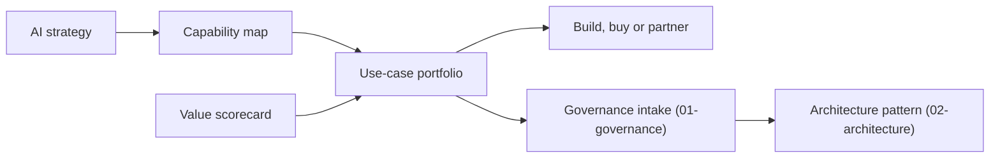

# 00 Strategy

Strategy comes first. It decides which AI work is worth doing, who sponsors it, and how value is measured. Every later folder (governance, architecture, operations) serves the choices made here.

| 5W1H | Answer |
|---|---|
| **Who** | CIO, chief AI officer, head of enterprise architecture, business unit leaders, finance partner |
| **What** | AI strategy, capability map, use-case portfolio, value scorecard, build-buy-partner guidance |
| **When** | Day-0 before the first use case; refreshed every quarter; reviewed when a major use case changes |
| **Where** | Owned by the AI program office or EA; stored in this repo so changes are versioned and reviewable |
| **Why** | Without a shared strategy, teams run disconnected pilots that never reach production or show value |
| **How** | Fill the templates, score each use case, review the portfolio quarterly at the AI steering forum |

## Files

| File | Purpose |
|---|---|
| [ai-strategy.md](ai-strategy.md) | One-page-to-five-page strategy template with guidance |
| [capability-map.md](capability-map.md) | Generic business capability map with AI heat-map columns |
| [use-case-portfolio.csv](use-case-portfolio.csv) | Single list of AI use cases with scores, tier and status |
| [value-scorecard.md](value-scorecard.md) | How to score value and feasibility the same way every time |
| [build-buy-partner.md](build-buy-partner.md) | Decision guide for sourcing each capability |

## How the pieces connect

## Minimum to start

1. Write the strategy on one page (vision, three priorities, guardrails, owners).
2. Mark the capability map with where AI could help most.
3. Put every known AI idea, pilot and vendor feature into the portfolio CSV.
4. Score them with the value scorecard. Pick three to five to move forward.
5. Send each chosen use case through [governance intake](../01-governance/README.md).
