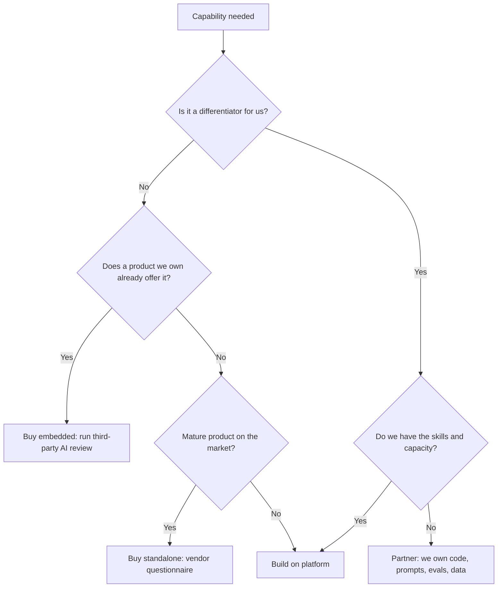

# Build, Buy or Partner

Most AI capability will be bought or embedded in software you already pay for. Build only where it differentiates you or where no product meets your controls.

| 5W1H | Answer |
|---|---|
| **Who** | Head of EA, sourcing or procurement, use-case sponsor, risk |
| **What** | A decision guide for how to source an AI capability |
| **When** | After a use case is scored and before design starts; again at contract renewal |
| **Where** | Record the decision as an [ADR](../02-architecture/adr/README.md) linked from the portfolio row |
| **Why** | Avoids building commodity features and avoids buying black boxes that fail governance |
| **How** | Answer the questions below, then apply the decision flow |

## Options

| Option | What it means | Typical example |
|---|---|---|
| **Buy (embedded)** | Turn on AI features in a SaaS product you already use | AI summaries in a CRM or service desk tool |
| **Buy (standalone)** | Purchase a dedicated AI product | A specialist document-processing product |
| **Build on platform** | Your team builds on the shared AI platform and LLM gateway | An internal policy assistant over your own documents |
| **Partner** | A system integrator or specialist builds with you; you own the result | A complex multi-agent workflow with a partner team |

## Decision flow

## Questions to answer

| # | Question | Leans to |
|---|---|---|
| 1 | Is this capability a source of competitive or mission advantage? | Build or partner |
| 2 | Does a product we already license offer it at acceptable quality? | Buy embedded |
| 3 | Can the vendor meet our data classification and hosting rules? | If no, build |
| 4 | Can we route the vendor's model calls through our gateway or get equivalent logs? | If no, extra controls or build |
| 5 | Will the vendor notify us before model or behaviour changes? | If no, risk of silent vendor update |
| 6 | Do we need to run our own evaluations on the outputs? | Build or buy with eval access |
| 7 | How locked-in would we be (prompts, data, fine-tunes, workflows)? | Prefer portable options |
| 8 | Total cost over three years including run cost and people? | Compare all options |
| 9 | Time to value? | Buy is usually faster |
| 10 | Who will run and support it at 2 a.m.? | Buy or partner if no internal ops team |

## Non-negotiables for every option

- The AI system goes in the AI inventory (`01-governance/ai-inventory.yaml`) with an internal owner.
- It receives a risk tier and follows the controls for that tier.
- Bought and partnered AI completes the [vendor questionnaire](../01-governance/templates/vendor-questionnaire.md) and the [third-party AI policy](../01-governance/policies/third-party-ai.md).
- For partnered work, the organization owns prompts, evaluation sets, data contracts and runbooks.

## Illustrative example

*Illustrative example (composite).* A hospital needed three things. Meeting summaries for administrators came embedded in its office suite (buy embedded). Coding support for clinical documentation was a mature market, so it bought a standalone product after the vendor questionnaire. A pathway assistant grounded in its own clinical guidelines was a differentiator, so it built on its platform with a partner and kept ownership of the prompts and test sets.
