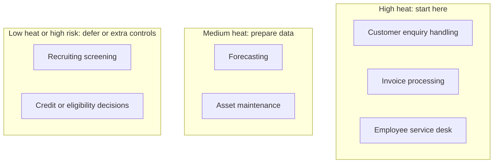

# Business Capability Map with AI Heat Map

A capability is what the business does, not how. Capabilities are stable; systems and org charts change. Mapping AI to capabilities keeps the portfolio tied to the business and shows where effort is piling up or missing.

| 5W1H | Answer |
|---|---|
| **Who** | Enterprise architects with business unit leads |
| **What** | A generic level-1 and level-2 capability map with columns to rate AI opportunity, readiness and risk |
| **When** | During strategy work; refreshed quarterly with the portfolio |
| **Where** | This file, or copied into your EA repository tool |
| **Why** | Shows where AI creates value, where data is ready, and where risk is high, on one page |
| **How** | Replace the generic capabilities with your own. Score each column 1 (low) to 3 (high). Colour the cells in your EA tool |

## Scoring columns

| Column | 1 | 2 | 3 |
|---|---|---|---|
| **Opportunity** | Little manual effort or variation | Moderate effort; some document or knowledge work | Heavy document, language, search or decision work |
| **Data readiness** | Data scattered, unowned, poor quality | Data exists with partial ownership | Owned, classified, accessible data with contracts |
| **Risk** | Internal, no effect on individuals | Customer-facing or regulated process | Decisions that materially affect people, safety or finances |
| **Current AI** | None | Pilots or vendor features | In production |

Heat = Opportunity + Data readiness − Risk adjustment. Use it to start a discussion, not to decide.

## Template

| L1 capability | L2 capability | Opportunity | Data readiness | Risk | Current AI | Candidate patterns | Portfolio ids |
|---|---|---|---|---|---|---|---|
| **Customer management** | Customer enquiry handling | | | | | conversational-customer-agent, rag-assistant | |
| | Complaint management | | | | | document-extraction, rag-assistant | |
| | Customer onboarding | | | | | document-extraction | |
| **Product and service delivery** | Order or case intake | | | | | document-extraction | |
| | Fulfilment and scheduling | | | | | classic-ml-with-genai-explanation | |
| | Quality inspection | | | | | vision-llm-report | |
| **Risk and compliance** | Regulatory change management | | | | | rag-assistant | |
| | Fraud and anomaly detection | | | | | anomaly-detection-agent-triage | |
| | Policy and control testing | | | | | tool-using-agent | |
| **Finance** | Invoice and payment processing | | | | | document-extraction | |
| | Forecasting and planning | | | | | classic-ml-with-genai-explanation | |
| | Financial close and reporting | | | | | content-generation, copilot-in-app | |
| **People** | Recruiting | | | | | content-generation (Tier 3 if screening) | |
| | Employee service desk | | | | | rag-assistant, conversational-customer-agent | |
| | Learning | | | | | content-generation | |
| **Technology** | Software delivery | | | | | copilot-in-app | |
| | IT operations and incident handling | | | | | anomaly-detection-agent-triage | |
| | Security operations | | | | | anomaly-detection-agent-triage, tool-using-agent | |
| **Operations and assets** | Asset maintenance | | | | | vision-llm-report, classic-ml-with-genai-explanation | |
| | Supply and logistics planning | | | | | classic-ml-with-genai-explanation, multi-agent-orchestration | |
| **Marketing and sales** | Campaign content | | | | | content-generation | |
| | Sales enablement | | | | | rag-assistant, copilot-in-app | |

Patterns are described in [02-architecture/patterns](../02-architecture/patterns/which-pattern-when.md).

## Heat-map view

## Illustrative example

*Illustrative example (composite).* A logistics firm mapped 40 L2 capabilities. Shipment exception handling and customs document intake scored highest. Driver scheduling scored high on opportunity but low on data readiness, so the firm funded a data contract first and deferred the AI work one quarter.
