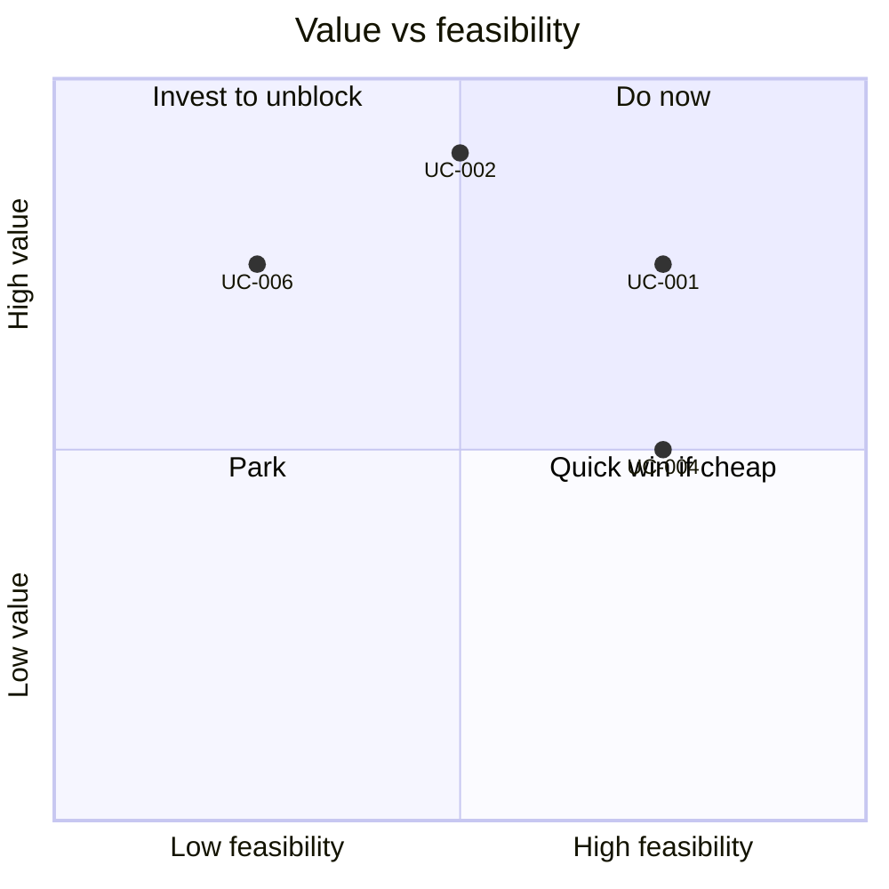

# Value Scorecard

Score every use case the same way so the portfolio can be compared fairly. The two numbers in [use-case-portfolio.csv](use-case-portfolio.csv) (`value_score`, `feasibility_score`) come from this scorecard.

| 5W1H | Answer |
|---|---|
| **Who** | Use-case sponsor scores value; delivery lead and architect score feasibility; finance partner checks the value numbers |
| **What** | A 1–5 scoring method for value and feasibility, plus the measures to track after go-live |
| **When** | At intake, at each stage gate, and 90 days after go-live |
| **Where** | Scores go in the portfolio CSV; the worksheet below goes in the use-case folder or ARB pack |
| **Why** | Stops the loudest sponsor winning. Makes "pilot purgatory" visible |
| **How** | Score each criterion, apply weights, round to the nearest whole number |

## Value criteria (weights add to 100%)

| Criterion | Weight | 1 | 3 | 5 |
|---|---|---|---|---|
| Time or cost saved | 30% | Minor saving for a few people | Noticeable saving for one team | Large saving across many teams |
| Revenue or service quality | 25% | No visible change | Measurable improvement for one segment | Clear improvement for a major segment |
| Risk reduction | 20% | None | Reduces known errors or backlogs | Reduces material regulatory, safety or financial risk |
| Strategic fit | 15% | Not in a strategy priority | Supports a priority | Core to a priority |
| Reuse | 10% | One-off | Reusable by one other team | Creates a reusable pattern or data asset |

## Feasibility criteria

| Criterion | Weight | 1 | 3 | 5 |
|---|---|---|---|---|
| Data readiness | 30% | Data unknown or unowned | Data exists, needs work | Owned, classified, with a data contract |
| Pattern maturity | 25% | New pattern for us | Pattern used once | Pattern in production, reusable |
| Integration effort | 20% | Many systems, no APIs | Some APIs | APIs and tools ready |
| Team skills | 15% | No skills in team | Partial | Team has shipped similar work |
| Risk tier burden | 10% | Tier 3 with open questions | Tier 2 | Tier 1 |

## Worksheet

| Criterion | Weight | Score (1–5) | Weighted |
|---|---|---|---|
| Time or cost saved | 0.30 | | |
| Revenue or service quality | 0.25 | | |
| Risk reduction | 0.20 | | |
| Strategic fit | 0.15 | | |
| Reuse | 0.10 | | |
| **Value score** | | | **sum** |

Repeat for feasibility.

## Portfolio quadrants

## Benefit measures after go-live

Write the baseline before build starts. A benefit without a baseline cannot be claimed.

| Measure type | Example measure | Source |
|---|---|---|
| Efficiency | Minutes per case, cases per person per day | Workflow system |
| Quality | Rework rate, error rate found in sampling | QA sampling |
| Experience | Customer or staff satisfaction for the journey | Survey |
| Adoption | Weekly active users, share of eligible cases using AI | Gateway and app telemetry |
| Cost | Cost per transaction (see [cost model](../finops/cost-model.md)) | FinOps |
| Risk | Incidents, overrides, complaints | Incident log, human review queue |

## Rules

- A use case with value score below 3 needs a written reason to proceed.
- A use case in pilot for more than two review cycles without meeting its measure goes to the steering forum to scale, change or stop.
- Re-score at 90 days after go-live using real data, not the original estimate.
