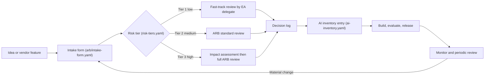

# 01 Governance

Governance in this kit is light for low-risk work and strict for high-risk work. Every AI system follows the same path: intake, risk tier, review in proportion to the tier, entry in the inventory, and monitoring for as long as it runs.

| 5W1H | Answer |
|---|---|
| **Who** | AI ARB (chaired by EA), risk and compliance, security, legal, data protection, use-case owners |
| **What** | Charter, RACI, policies, ARB process, impact assessments, templates and control maps |
| **When** | Before build (intake), before production (release review), on material change, and at scheduled reviews |
| **Where** | Intake and decisions live in this repo; the AI inventory (`ai-inventory.yaml`) is the system of record for what is running |
| **Why** | So that every AI system is known, owned, proportionately controlled and can be stopped |
| **How** | Use the intake form; the tier sets the review depth; decisions go in the decision log; controls are enforced at the gateway and in CI where possible |

## The flow

## Risk tiers in one line each

The authoritative tier rules are in `risk-tiers.yaml` (maintained separately). The summary used across this kit:

| Tier | Typical profile | Review | Max autonomy (see [autonomy levels](../ops/autonomy-levels.md)) |
|---|---|---|---|
| Tier 1 | Internal, low impact, public or internal data, human uses output as a suggestion | Fast-track | Up to L4 with ARB approval |
| Tier 2 | Customer-facing, or confidential data, or affects business decisions | ARB standard | Up to L3 |
| Tier 3 | Materially affects individuals' rights, finances, health, safety or access to services; regulated high-risk use | Impact assessment + full ARB | Up to L2 |

## Contents

| Path | Purpose |
|---|---|
| [charter.md](charter.md) | AI program charter template |
| [raci.md](raci.md) | Who does what |
| [policies/](policies/) | Acceptable use, data use, human oversight, third-party AI |
| [arb/](arb/README.md) | ARB terms of reference, intake form, checklist, decision log |
| [impact-assessments/](impact-assessments/template.md) | AI impact assessment for Tier 3 |
| [templates/](templates/) | ADR, system card, model card, vendor questionnaire, case study |
| [control-maps/](control-maps/README.md) | Mapping to NIST AI RMF, ISO/IEC 42001, EU AI Act, OWASP LLM Top 10 |
| `risk-tiers.yaml`, `ai-inventory.yaml`, `policy-as-code/` | Machine-readable tiers, inventory and automated checks (maintained separately) |

## Principles

1. **Proportionate.** Tier 1 should take days, not months. Effort goes where risk is.
2. **Enforced, not just written.** Controls that can be automated (gateway rules, CI checks) are automated.
3. **One inventory.** If it is not in the inventory, it does not run in production.
4. **Someone can stop it.** Every system has a kill switch at the gateway and a named person who can use it.
5. **Reuse existing governance.** The AI ARB plugs into the existing architecture, change and risk processes. It does not replace them.

## Illustrative example

*Illustrative example (composite).* A public agency had 30 AI ideas in a spreadsheet and no review process. In week one it adopted the intake form. Twenty ideas were Tier 1 and cleared fast-track within a fortnight. Seven were Tier 2 and went to the first ARB. Three involved benefit eligibility and were Tier 3; each received an impact assessment before any build started.
