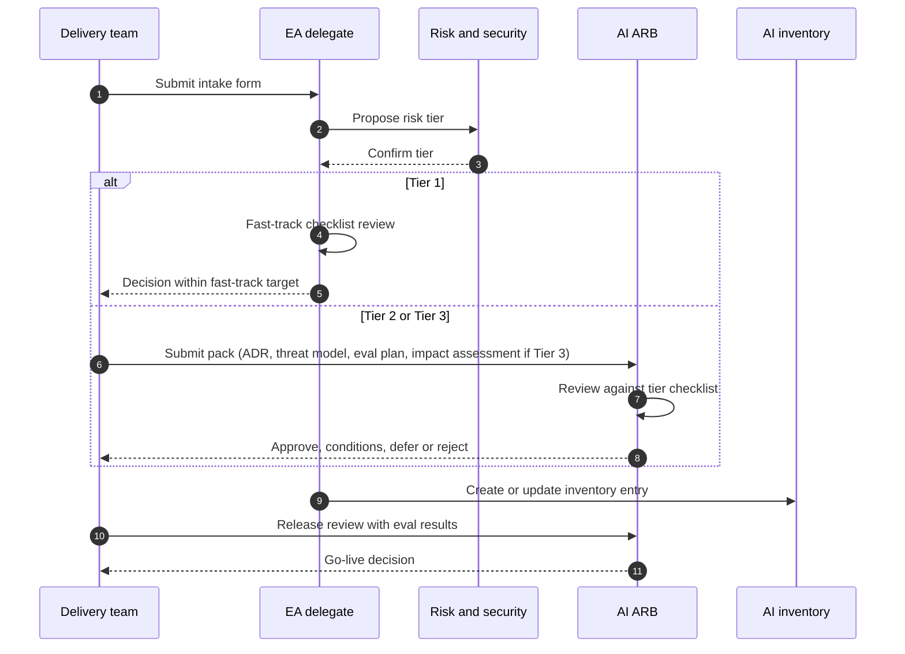

# AI Architecture Review Board: Terms of Reference

| 5W1H | Answer |
|---|---|
| **Who** | Chair: head of EA. Members: platform lead, security, risk and compliance, data protection, data owner, legal (Tier 3), business sponsor of the item |
| **What** | Reviews AI systems before build and before release; approves, conditions or rejects; owns the decision log |
| **When** | Weekly for standard reviews (set `governance.arb_cadence` in `kit.yaml`); ad hoc for urgent items; fast-track Tier 1 reviews (asynchronous checklist; target set in `risk-tiers.yaml`, default 2 business days) |
| **Where** | Virtual or in person; papers submitted through this repo as pull requests |
| **Why** | One place where architecture, risk and business agree, so teams get a clear and timely answer |
| **How** | Intake form → tiering → pack → review against the checklist → decision → inventory update |

## 1. Purpose

The AI ARB makes sure each AI system fits the reference architecture, meets the controls for its risk tier, and has an owner who can run and stop it.

The AI ARB is a specialty board under the existing architecture review process. It does not replace change advisory, risk committees or privacy reviews; it feeds them.

## 2. Scope

- New AI use cases, built or bought.
- Material changes: new model family, new data source, higher autonomy, new user group, new region, tier change.
- Exceptions to AI policies or standards.
- Additions to the approved model list.

## 3. Membership and quorum

| Role | Tier 1 | Tier 2 | Tier 3 |
|---|---|---|---|
| ARB chair or EA delegate | Required | Required | Required |
| Platform lead | Optional | Required | Required |
| Security | Optional | Required | Required |
| Risk and compliance | — | Required | Required |
| Data protection | If personal data | If personal data | Required |
| Legal | — | Optional | Required |
| Business sponsor | Required | Required | Required |

**Quorum:** chair plus all "Required" roles for the item's tier. A delegate with authority may attend in place of a member.

## 4. Cadence

| Meeting | Frequency | Content |
|---|---|---|
| Fast-track (Tier 1) | Asynchronous, within the `risk-tiers.yaml` target (default 2 business days) | EA delegate reviews pack and checklist |
| Standard ARB | Weekly by default (`kit.yaml` → `governance.arb_cadence`); fortnightly is fine at low volume | Tier 2 and Tier 3 design and release reviews |
| Quarterly review | Every quarter | Inventory health, open conditions, incidents, exceptions due to expire |

## 5. Decision types

| Decision | Meaning |
|---|---|
| **Approved** | Proceed as proposed |
| **Approved with conditions** | Proceed; conditions must be closed by stated dates and are tracked |
| **Deferred** | More information needed; resubmit |
| **Rejected** | Do not proceed; reasons recorded |
| **Exception granted** | Deviation from a policy or standard, time-limited, with compensating controls |

Decisions go in the [decision log](decision-log.md) within two working days.

## 6. Review sequence

## 7. Pack contents by tier

| Item | Tier 1 | Tier 2 | Tier 3 |
|---|---|---|---|
| [Intake form](intake-form.yaml) | Yes | Yes | Yes |
| [ADR](../templates/adr-ai.md) | Short | Yes | Yes |
| [System card](../templates/system-card.yaml) | Yes | Yes | Yes |
| [Threat model](../../security/threat-models/template.md) | — | Yes | Yes |
| Evaluation plan and results | Basic | Yes | Yes, with fairness tests |
| [Impact assessment](../impact-assessments/template.md) | — | — | Yes |
| [Vendor questionnaire](../templates/vendor-questionnaire.md) | If bought | If bought | If bought |
| [Model card](../templates/model-card.yaml) | If classic ML | If classic ML | If classic ML |

## 8. Service levels

- Tier 1 fast-track: decision within the `risk-tiers.yaml` target (default 2 business days) of a complete pack.
- Tier 2 and Tier 3: scheduled at the next ARB after a complete pack, normally within 10 working days.
- The chair publishes ARB throughput and wait times quarterly.

## 9. Conflicts of interest

Members declare any interest in an item. The chair decides whether they may take part in the decision.

## 10. Escalation

Disagreements that the ARB cannot resolve go to the AI steering forum. The chief risk officer may block a Tier 3 item pending escalation.
