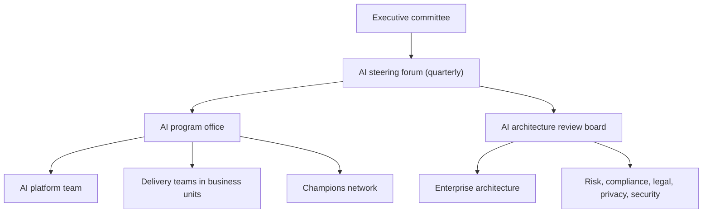

# AI Program Charter (Template)

Replace text in angle brackets. Keep the charter to two or three pages. It sets authority; details live in policies and the ARB terms of reference.

| 5W1H | Answer |
|---|---|
| **Who** | Sponsored by the CIO or chief AI officer; approved by the executive committee |
| **What** | The mandate, scope, decision rights and structure of the AI program |
| **When** | Approved at program start; reviewed every year |
| **Where** | This repo and the corporate governance register |
| **Why** | Gives the ARB and program office the authority to approve, condition or stop AI work |
| **How** | Fill each section, get sign-off, publish to all staff |

---

## 1. Purpose

The AI program exists to <deliver business value from AI safely, lawfully and at scale> in line with the [AI strategy](../00-strategy/ai-strategy.md).

## 2. Scope

**In scope:** all AI systems built, bought, embedded or used by <Organization>, including generative AI, machine learning models, AI agents, and AI features in third-party software.

**Out of scope:** <for example, simple rules engines with no learned component>.

## 3. Objectives

1. Keep a complete inventory of AI systems with named owners.
2. Apply risk-tiered controls to every AI system.
3. Provide a shared platform so teams deliver faster and safely.
4. Measure value and cost for every production use case.
5. Build AI literacy across the workforce.

## 4. Structure

## 5. Decision rights

| Decision | Made by | Escalation |
|---|---|---|
| Strategy and funding priorities | AI steering forum | Executive committee |
| Risk tier assignment | ARB (EA delegate for Tier 1) | Chief risk officer |
| Approve, condition or reject an AI system | ARB | AI steering forum |
| Approved models and providers | ARB on platform team recommendation | AI steering forum |
| Stop (kill switch) an AI system in production | System owner, platform on-call, or CISO | None needed; review after |
| Policy changes | Policy owner with ARB review | Executive committee for major changes |

## 6. Roles

| Role | Holder | Responsibility |
|---|---|---|
| Executive sponsor | <name, title> | Accountable for the program |
| Chief AI officer or program lead | <name> | Runs the program day to day |
| ARB chair | <head of EA> | Runs reviews, owns the decision log |
| Platform owner | <name> | Owns the shared AI platform and gateway |
| Risk lead | <name> | Owns risk tiering rules and impact assessments |
| Data protection lead | <name> | Privacy requirements and assessments |

Full responsibilities are in the [RACI](raci.md).

## 7. Policies under this charter

- [Acceptable use](policies/acceptable-use.md)
- [Data use for AI](policies/data-use.md)
- [Human oversight](policies/human-oversight.md)
- [Third-party AI](policies/third-party-ai.md)

## 8. Reporting

The program office reports quarterly to the steering forum on: inventory size by tier, use cases by stage, value delivered, cost, incidents, open ARB conditions, and maturity level.

## 9. Review

This charter is reviewed every 12 months or after a significant change in law, strategy or incident history.

## 10. Approval

| Role | Name | Signature | Date |
|---|---|---|---|
| Executive sponsor | | | |
| Chief risk officer | | | |
| General counsel | | | |
