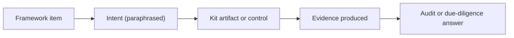

# Control Maps

These maps show how the blueprint's artifacts line up with widely used AI frameworks, standards, regulation and security lists. They help you answer an auditor, regulator or customer who asks "how do you cover X?"

| 5W1H | Answer |
|---|---|
| **Who** | Risk and compliance, internal audit, EA, security |
| **What** | Tables from external framework items to blueprint artifacts and the evidence they produce |
| **When** | When preparing for audit, certification, customer due diligence or regulatory review |
| **Where** | This folder; reference from your GRC tool |
| **Why** | Do the work once in the blueprint, then show coverage for many frameworks |
| **How** | Each map lists the framework item, a short intent in our own words, the blueprint artifact, and the evidence |

## Maps

| File | Framework | Level of mapping |
|---|---|---|
| [nist-ai-rmf.md](nist-ai-rmf.md) | NIST AI Risk Management Framework 1.0 (NIST AI 100-1) | Category |
| [iso-42001.md](iso-42001.md) | ISO/IEC 42001:2023 AI management system | Annex A control area, plus clauses 4–10 |
| [eu-ai-act.md](eu-ai-act.md) | EU Artificial Intelligence Act | Risk class and obligation group |
| [owasp-llm-top10.md](owasp-llm-top10.md) | OWASP Top 10 for LLM Applications (2025) | Each risk |

## Approach

1. **Paraphrase, do not copy.** Intents are written in our own words. Standards text is copyrighted and changes between versions. Always check the official text.
2. **Map to artifacts that produce evidence.** A policy alone is weak evidence. Prefer artifacts that leave a record: decision log rows, inventory entries, eval reports, gateway logs.
3. **One artifact, many frameworks.** The ARB decision log, for example, supports NIST GOVERN, ISO 42001 A.6 and EU AI Act record-keeping.
4. **Gaps are stated.** Where the blueprint gives only partial coverage, the map says so. You fill the gap with your own controls.

## Important limits

- These maps are aids, not certifications or legal opinions.
- Verify every row against the current official or licensed text before using it in an audit or regulatory submission.
- Your legal team decides how regulation applies to you.
