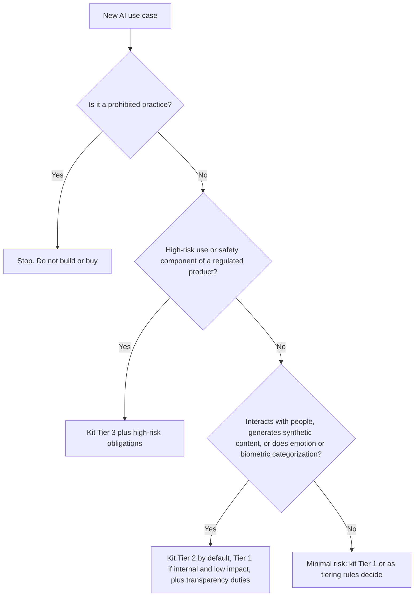

# Control Map: EU Artificial Intelligence Act

> **Not legal advice.** This map helps architecture and risk teams organize work. Legal counsel must decide how the Act applies to your systems and your role (provider, deployer, importer, distributor). Obligations apply in phases; check the current official timetable, since some dates have been subject to proposed amendments.

| 5W1H | Answer |
|---|---|
| **Who** | Legal, compliance, risk, EA, system owners with EU users or EU-placed systems |
| **What** | The Act's risk classes and general-purpose AI obligations mapped to kit tiers and controls |
| **When** | At intake (classification), design, release and in operation |
| **Where** | Any AI system placed on the EU market or whose output is used in the EU |
| **Why** | The Act sets binding obligations with significant penalties |
| **How** | Classify at intake, map to kit tier, apply the controls, keep the evidence |

## Phased application (summary)

The Act entered into force in August 2024 and applies in stages. In outline:

| Stage | What starts to apply (summary) |
|---|---|
| Early 2025 | Prohibited practices; AI literacy duties |
| Mid 2025 | General-purpose AI model obligations; governance and penalty provisions |
| Mid 2026 onward | Most remaining obligations, including many high-risk system rules |
| Later stages | High-risk rules for AI in products covered by existing EU product legislation |

Verify exact dates and any amendments in the Official Journal or the European Commission's current guidance before relying on them.

## Classification at intake

The kit tier is set by `risk-tiers.yaml`. The Act classification is a minimum: other factors can raise the kit tier.

## Risk classes mapped to the kit

| Act risk class | Plain summary | Kit tier (minimum) | Key kit controls | Evidence |
|---|---|---|---|---|
| **Prohibited** | Practices banned outright (for example certain manipulation, social scoring and some biometric uses) | Not allowed | `policies/acceptable-use.md` 5.1; intake screening question | Intake record showing screening |
| **High-risk** | Uses in listed sensitive areas (such as employment, credit, essential services, education, critical infrastructure) or safety components of regulated products | Tier 3 | Impact assessment; `policies/human-oversight.md`; L2 maximum autonomy; data contracts; logging standard; system card; eval and fairness tests; incident runbook | Signed assessment, system card, eval reports, logs, decision log |
| **Limited risk (transparency)** | Systems that interact with people or create synthetic content must disclose this | Tier 2 by default (Tier 1 if internal and low impact) | AI disclosure in UI (`acceptable-use.md` 8.1–8.2); content labelling in `content-generation` pattern | UI copy, labelling configuration |
| **Minimal risk** | Everything else; voluntary codes encouraged | Tier 1 | Standard kit baseline | Inventory entry, basic eval |

## High-risk obligation groups mapped to kit artifacts

| Obligation group (summary) | Kit artifact |
|---|---|
| Risk management system across the life cycle | `risk-tiers.yaml`, impact assessment, ARB process, ops runbooks |
| Data governance and quality | `data/contracts/`, `data/lineage/`, `policies/data-use.md` |
| Technical documentation | System card, model card, ADRs, eval reports |
| Record-keeping and logging | `02-architecture/standards/logging-standard.md`, gateway traces |
| Transparency and information to deployers | System card `known_limitations`, `transparency_notice` |
| Human oversight | `policies/human-oversight.md`, `ops/autonomy-levels.md` |
| Accuracy, robustness and cybersecurity | Pattern eval approach, `security/` threat model and red team |
| Quality management (providers) | ISO/IEC 42001 mapping, ARB checklist |
| Post-market monitoring and serious incident reporting | `ops/slo.yaml`, `ops/runbooks/ai-incident.md` notify step |
| Deployer duties (use as instructed, monitor, keep logs, inform affected people) | Acceptable use, human oversight, logging standard |

## General-purpose AI (GPAI) models

| Topic | Summary | Kit relevance |
|---|---|---|
| GPAI provider obligations | Technical documentation, information for downstream providers, copyright policy, training-data summary | Mostly falls on model providers. Kit collects this through the vendor questionnaire |
| GPAI with systemic risk | Extra evaluation, incident reporting and cybersecurity duties for the most capable models | Provider duty; check your providers' public commitments |
| Building on GPAI | If you integrate a GPAI model into your own system, you may become the provider of that system | Classify the system at intake; follow tier controls |
| Fine-tuning or significant modification | Can change your role and obligations | ADR plus legal review required (see `02-architecture/adr/`) |

## AI literacy

The Act expects organizations to take steps for sufficient AI literacy of staff dealing with AI systems. Kit artifact: [learning paths](../../enablement/learning-paths.md), with completion records as evidence.
