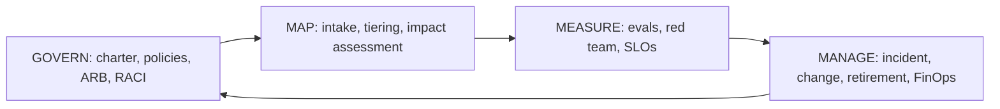

# Control Map: NIST AI RMF 1.0

> **Note:** Mapped at category level; verify subcategory wording against the official NIST AI 100-1 before audit use. Intents below are short paraphrases in our own words, not NIST text.

| 5W1H | Answer |
|---|---|
| **Who** | Risk, compliance, audit, EA |
| **What** | Kit artifacts mapped to the 19 categories of the four NIST AI RMF functions |
| **When** | Program set-up, audit preparation, annual review |
| **Where** | This file |
| **Why** | NIST AI RMF is a common reference for AI risk programs, including outside the US |
| **How** | Find the category, use the listed artifacts, collect the listed evidence |

## How the functions fit the kit

## GOVERN

| Category | Intent (paraphrased) | Kit artifact(s) | Evidence produced |
|---|---|---|---|
| GOVERN 1 | Policies and processes for AI risk exist, are clear and are followed | `01-governance/charter.md`, `policies/`, `risk-tiers.yaml`, `policy-as-code/` | Approved policies, policy-as-code check results |
| GOVERN 2 | Clear accountability; people are trained and empowered | `raci.md`, `charter.md`, `enablement/learning-paths.md` | Signed RACI, training completion records |
| GOVERN 3 | Diverse perspectives and accessibility are considered in AI risk work | ARB membership (`arb/README.md`), `impact-assessments/template.md` (affected people), `enablement/champions-network.md` | ARB attendance, impact assessments listing affected groups. *Partial: add your own inclusion practices* |
| GOVERN 4 | A culture where AI risk is discussed and reported | `policies/acceptable-use.md` (good-faith reporting), `enablement/`, `docs/anti-patterns.md` | Incident reports, training records |
| GOVERN 5 | Engagement with people outside the AI team, including affected parties | `impact-assessments/template.md`, `policies/human-oversight.md` (contest and redress) | Stakeholder input in assessments, contest logs |
| GOVERN 6 | Third-party software, data and supply-chain risks are governed | `policies/third-party-ai.md`, `templates/vendor-questionnaire.md`, `00-strategy/build-buy-partner.md` | Completed questionnaires, contract clauses, inventory vendor fields |

## MAP

| Category | Intent (paraphrased) | Kit artifact(s) | Evidence produced |
|---|---|---|---|
| MAP 1 | Context, purpose and setting of the AI system are understood | `arb/intake-form.yaml`, `00-strategy/use-case-portfolio.csv` | Intake records, portfolio rows |
| MAP 2 | The AI system is categorized (task, methods, limits) | Intake `pattern`, `risk-tiers.yaml`, `templates/system-card.yaml` | Tier decision, system card |
| MAP 3 | Capabilities, intended use, benefits and costs are understood | `00-strategy/value-scorecard.md`, `finops/cost-model.md`, ADRs | Scorecards, cost estimates, ADR options |
| MAP 4 | Risks and benefits of every component, including third-party parts, are mapped | `security/threat-models/template.md`, `data/contracts/`, vendor questionnaire | Threat models, data contracts |
| MAP 5 | Impacts on individuals, groups, organizations and society are described | `impact-assessments/template.md`, `enablement/workforce-impact-assessment.md` | Signed impact and workforce assessments |

## MEASURE

| Category | Intent (paraphrased) | Kit artifact(s) | Evidence produced |
|---|---|---|---|
| MEASURE 1 | Suitable methods and metrics are chosen and applied | Pattern "eval approach" sections, `arb/review-checklist.md` | Eval plans with thresholds |
| MEASURE 2 | Systems are evaluated for trustworthiness (validity, safety, security, fairness, privacy, explainability) | Eval reports, `security/red-team/`, fairness tests in impact assessment | Eval and red-team reports |
| MEASURE 3 | Risks are tracked over time | `ops/slo.yaml`, `02-architecture/standards/logging-standard.md`, override monitoring in `policies/human-oversight.md` | Dashboards, SLO reports, override rates |
| MEASURE 4 | Feedback on whether measurement works is collected and used | Quarterly ARB review, post-release reviews at 30 and 90 days | Review minutes, updated thresholds |

## MANAGE

| Category | Intent (paraphrased) | Kit artifact(s) | Evidence produced |
|---|---|---|---|
| MANAGE 1 | Risks are prioritized and a response chosen | `arb/decision-log.md` (conditions), impact assessment risk table | Decisions with conditions and owners |
| MANAGE 2 | Benefits are maximized and harms reduced, with plans to disengage if needed | `ops/autonomy-levels.md`, kill switch in `ops/runbooks/ai-incident.md`, `ops/runbooks/model-retirement.md` | Kill-switch tests, autonomy approvals |
| MANAGE 3 | Third-party risks are managed in operation | `policies/third-party-ai.md`, `ops/runbooks/model-version-change.md` | Vendor change records, re-evaluation results |
| MANAGE 4 | Response, recovery and communication plans are documented and monitored | `ops/runbooks/ai-incident.md`, `ops/README.md` | Incident records, post-incident reviews |

## Known gaps

- Workforce diversity practices (part of GOVERN 3) sit mostly with HR, outside the kit.
- Societal-level impact (part of MAP 5) needs organization-specific input.
