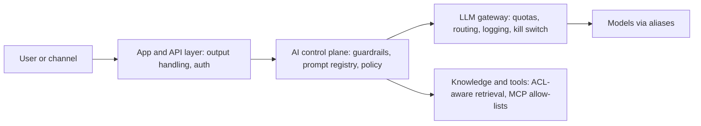

# Control Map: OWASP Top 10 for LLM Applications (2025)

> Descriptions are short paraphrases. See the OWASP GenAI Security Project for the full text and examples.

| 5W1H | Answer |
|---|---|
| **Who** | Security architects, platform team, delivery teams, red team |
| **What** | Each OWASP LLM risk mapped to blueprint controls, where they are enforced, and the test that proves them |
| **When** | Threat modelling (design), red teaming (release), monitoring (run) |
| **Where** | LLM gateway, retrieval layer, agent runtime, application code |
| **Why** | Gives a shared checklist for LLM-specific security risk |
| **How** | Every Tier 2+ threat model walks through these ten items |

## Where controls sit

## Map

| # | Risk | Short intent (paraphrased) | Blueprint controls | Enforced at | Test or evidence |
|---|---|---|---|---|---|
| LLM01 | Prompt Injection | Crafted input, direct or hidden in content, changes the model's behaviour | Input guardrails and injection shields; treat retrieved content as data; tool allow-lists; human approval for high-impact actions | Control plane, gateway, agent runtime | `security/red-team/prompts.jsonl` injection cases; red-team report |
| LLM02 | Sensitive Information Disclosure | The model reveals personal, confidential or secret data | Data classification hosting rules; output redaction; permission-aware retrieval; minimization | Gateway, retrieval layer | Data-exfil red-team cases; ACL tests |
| LLM03 | Supply Chain | Compromised or poorly governed models, datasets, plugins or vendors | Approved model list; vendor questionnaire; model aliases; signed artifacts; dependency scanning | Platform, procurement | Approved model records, questionnaires |
| LLM04 | Data and Model Poisoning | Training, fine-tuning or retrieval data is tampered with | Data contracts with owners and quality rules; lineage; controlled ingestion; review of fine-tune data | Data layer | Contract checks, lineage records |
| LLM05 | Improper Output Handling | Model output used downstream without validation (for example in code, queries or HTML) | Treat output as untrusted; schema validation; encoding; no direct execution | Application layer | Unit tests, output schema checks |
| LLM06 | Excessive Agency | Agents have more tools, permissions or autonomy than needed | Non-human identities with least-privilege scopes (`agent-scopes.yaml`); MCP allow-lists; autonomy caps by tier; approval steps | Agent runtime, identity | Scope reviews, autonomy approvals in decision log |
| LLM07 | System Prompt Leakage | System prompts expose secrets, rules or internal logic | No secrets or business rules in prompts; prompts in registry; leakage tests | Prompt registry, control plane | Leakage red-team cases |
| LLM08 | Vector and Embedding Weaknesses | Weak access control or tampering in vector stores and embeddings | ACL source in data contracts; per-user filtering at retrieval; index isolation by class; ingestion controls | Retrieval layer | Cross-user retrieval tests |
| LLM09 | Misinformation | Confident but false or unsupported output is relied upon | Grounding with citations; groundedness evals; "I don't know" behaviour; human review by tier | Control plane, evals | Groundedness scores, eval reports |
| LLM10 | Unbounded Consumption | Uncontrolled use drives cost, denial of service or model extraction | Gateway quotas and rate limits; token caps; budgets and alerts (`finops/budgets.yaml`) | Gateway, FinOps | Quota config, budget alerts |

## Related artifacts

- [Threat model template](../../security/threat-models/template.md)
- [Red-team prompts](../../security/red-team/prompts.jsonl)
- [Integration standards](../../02-architecture/standards/integration-standards.md)
