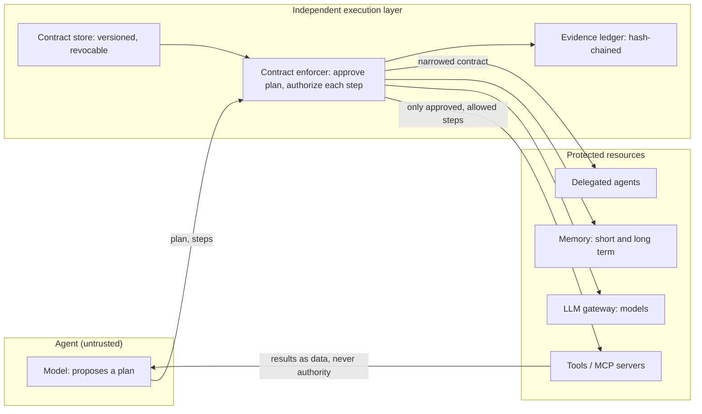
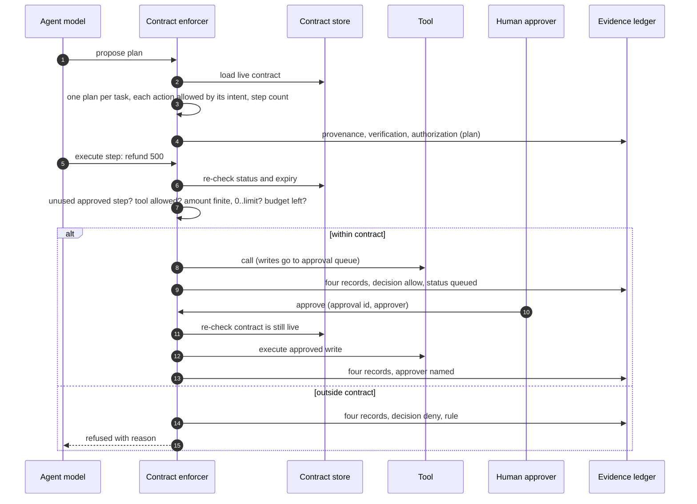

# Agent contracts: executable, enforced, auditable

> **The model proposes. The contract defines obligations. An independent execution layer enforces them.**

| | |
|---|---|
| **What** | A machine-readable contract per agent that binds planning, models, data, memory, tools, delegation and execution, enforced outside the agent, with four kinds of evidence for every step |
| **Why** | An agent cannot be trusted to police itself. The test is not whether it behaves when things go well, but whether the architecture prevents and audits unauthorized actions when the model fails, instructions conflict or a delegate oversteps |
| **Who** | System owner writes the contract; AI ARB approves it; platform team operates the enforcer; risk and audit read the evidence |
| **When** | Required for autonomy L2+ and for tool-using, conversational or multi-agent patterns (checked by the policy gate) |
| **Where** | `contracts/*.yaml` · `platform/core/kit/contracts.py` · `enforcer.py` · `evidence.py` |
| **How** | One plan approval per task; each approved step runs once; per-step authorization against the live contract; human approvals recorded by the enforcer; narrowing and a shared budget on delegation; hash-chained, anchored evidence |

## Documented vs executable

| | Documented contract | Executable contract (this blueprint) |
|---|---|---|
| Where it lives | Policy PDF, wiki | `contracts/<agent>.yaml`, versioned in Git |
| Who checks it | Reviewers, occasionally | CI policy gate on every change; enforcer on every step |
| What it covers | Usually tools only | Planning, models, data classes, memory, tools, delegation, execution limits |
| What happens on breach | Found in an audit, later | Step refused, recorded, and visible at once |
| Change control | Email approval | ARB id in the contract; expiry date; instant revocation |

## Architecture



The agent holds no reference to tools, models or memory. In production, run the enforcer as its own service (sidecar, API or MCP gateway) so agents have no network path around it. The reference code keeps it in-process so it runs anywhere for learning.

## One step, end to end



## Four kinds of evidence

Provenance, verification, authorization and successful execution are different facts. Each step writes all four, linked by an action id, even when the step is denied.

| Record | Answers | Example fields |
|---|---|---|
| **Provenance** | Where did this come from? | task source, plan hash, step hash, intent, delegation chain |
| **Verification** | What was checked, and what did it find? | in approved plan, tool allowed, amount ≤ limit, cost so far |
| **Authorization** | Who or what allowed it, under which rule? | allow/deny, contract id@version, rule, approver |
| **Execution** | What actually happened? | done, queued or failed; output hash; approval id; cost |

Records are hash-chained, so an edit, deletion or reordering is detected by `EvidenceLedger.verify()`. A chain alone cannot show that records were cut off the end, so `anchor()` returns the record count and head hash; store it where the agent runtime cannot write (WORM storage, a separate log, a signed checkpoint) and pass it to `verify(anchor)`.

Human approval is evidence too: approvals go through `enforcer.approve(task, approval_id, approver)`, which re-checks the live contract and writes four records naming the approver. A queued write cannot be approved after its contract is revoked or expired.

## Intents are bound to actions

An intent is not a label. Each intent in the contract lists exactly which tools, models, memory stores (`short`, `long`) or delegates it may use:

```yaml
planning:
  intents:
    check_history:   {tools: [get_fee_history]}
    request_refund:  {tools: [request_fee_refund]}
    explain_fee:     {models: [reasoning-large, reasoning-small]}
    delegate_lookup: {delegates: [fee-lookup-agent]}
```

A plan step labelled `explain_fee` that tries to delegate is rejected at plan approval. Memory is bound to the task's subject (user and conversation from the task source), so a step cannot read another customer's memory.

## Delegation only narrows

When agent A delegates to agent B, B runs under `narrow(A, B)`:
- intents (and each intent's actions), models, data classes, memory keys, tools and delegates are **intersections**;
- refund limits, step counts, cost and tool-call limits take the **tighter** value;
- autonomy takes the **lower** level, and delegation depth drops by one.

So B can never gain authority that A lacks. B also draws on A's **budget**: cost and tool calls are counted once across the whole delegation chain, so fan-out cannot multiply the limits. Revoking A stops B at its next step.

## Failure modes covered by tests

`tests/test_contracts.py` has 42 tests. The main ones:

| Failure | Control | Test |
|---|---|---|
| Model follows an injected instruction ("ignore limits") | Authority read only from the contract | `test_conflicting_instruction_cannot_widen_authority` |
| Model acts outside its approved plan | Step must match an unused approved step | `test_model_deviating_from_approved_plan_is_blocked` |
| Model replays an approved step, or re-plans mid-task | Each step runs once; one plan per task | `test_approved_step_cannot_be_replayed`, `test_only_one_plan_per_task` |
| Intent label does not match the action | Intent → action mapping | `test_intent_must_match_its_action` |
| Malformed step or enforcer error | Recorded as deny (rule `validation`), never allow | `test_malformed_steps_are_denied_not_allowed` |
| NaN, negative, missing or over-limit amount | Amount validation | `test_amount_must_be_finite_and_in_range` |
| Delegate exceeds scope | Narrowed contract | `test_delegate_cannot_exceed_parent_scope` |
| Fan-out multiplies limits | Shared budget across the chain | `test_delegation_shares_the_parent_budget` |
| Undeclared delegate or depth exceeded | Delegation rules | `test_undeclared_delegate_and_depth_limit` |
| Incident: stop one agent now | Revocation, re-checked each step | `test_revocation_stops_a_running_task`, `test_revoking_parent_stops_delegate` |
| Queued write approved after revocation | Approval through the enforcer, approver recorded | `test_queued_write_cannot_be_approved_after_revocation` |
| Runaway cost or tool use | Execution limits | `test_cost_limit_stops_model_calls`, `test_tool_call_limit` |
| Memory overreach or another customer's memory | Allowed keys; subject binding | `test_memory_keys_are_bound`, `test_memory_is_bound_to_the_task_subject` |
| Evidence edited, deleted or truncated | Hash chain plus external anchor | `test_evidence_chain_detects_tampering`, `test_evidence_chain_detects_deletion`, `test_truncation_is_detected_with_an_anchor` |
| Unchecked or duplicate contract in the repo | Policy gate; runtime loads only inventory contracts | `test_policy_gate_flags_orphan_and_duplicate_contracts` |

## Limits of the reference implementation
- In-process enforcer: production needs it as a separate service with no bypass path.
- Plan steps are structured actions; free-form model reasoning is not inspected, only what it asks to do.
- The ledger is in memory; export to WORM storage and keep anchors outside the runtime for real audit use.
- Budgets and used-step state live in the task object; a production service persists them so a restart cannot reset them.
- Approver identity is passed in; production takes it from the identity provider, not from the caller.
