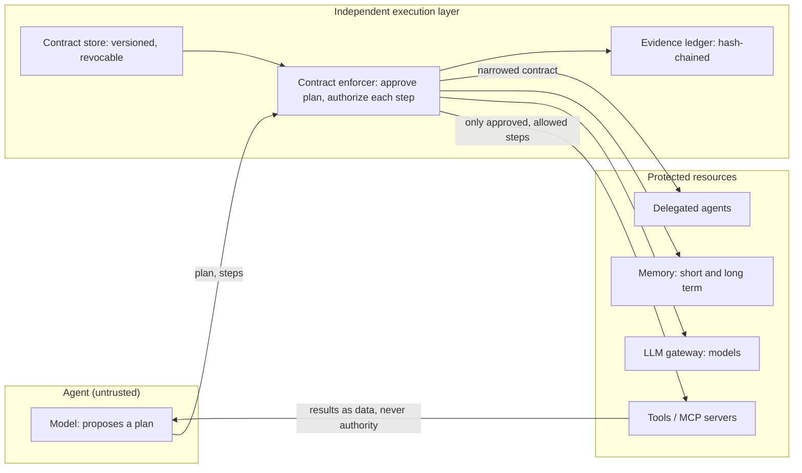
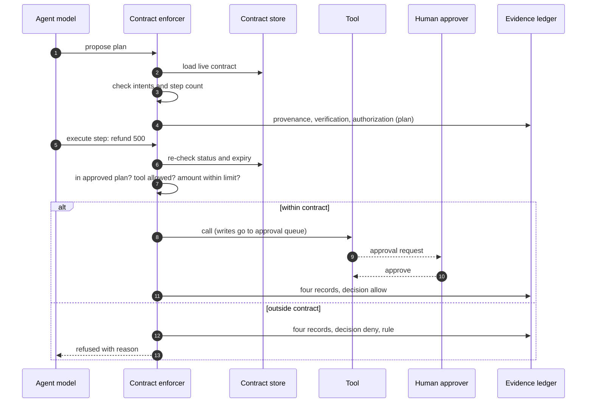

# Agent contracts: executable, enforced, auditable

> **The model proposes. The contract defines obligations. An independent execution layer enforces them.**

| | |
|---|---|
| **What** | A machine-readable contract per agent that binds planning, models, data, memory, tools, delegation and execution, enforced outside the agent, with four kinds of evidence for every step |
| **Why** | An agent cannot be trusted to police itself. The test is not whether it behaves when things go well, but whether the architecture prevents and audits unauthorized actions when the model fails, instructions conflict or a delegate oversteps |
| **Who** | System owner writes the contract; AI ARB approves it; platform team operates the enforcer; risk and audit read the evidence |
| **When** | Required for autonomy L2+ and for tool-using, conversational or multi-agent patterns (checked by the policy gate) |
| **Where** | `contracts/*.yaml` · `platform/core/kit/contracts.py` · `enforcer.py` · `evidence.py` |
| **How** | Plan approval before execution; per-step authorization against the live contract; narrowing on delegation; hash-chained evidence |

## Documented vs executable

| | Documented contract | Executable contract (this blueprint) |
|---|---|---|
| Where it lives | Policy PDF, wiki | `contracts/<agent>.yaml`, versioned in Git |
| Who checks it | Reviewers, occasionally | CI policy gate on every change; enforcer on every step |
| What it covers | Usually tools only | Planning, models, data classes, memory, tools, delegation, execution limits |
| What happens on breach | Found in an audit, later | Step refused, recorded, and visible at once |
| Change control | Email approval | ARB id in the contract; expiry date; instant revocation |

## Architecture

The agent holds no reference to tools, models or memory. In production, run the enforcer as its own service (sidecar, API or MCP gateway) so agents have no network path around it. The reference code keeps it in-process so it runs anywhere for learning.

## One step, end to end

## Four kinds of evidence

Provenance, verification, authorization and successful execution are different facts. Each step writes all four, linked by an action id, even when the step is denied.

| Record | Answers | Example fields |
|---|---|---|
| **Provenance** | Where did this come from? | task source, plan hash, step hash, intent, delegation chain |
| **Verification** | What was checked, and what did it find? | in approved plan, tool allowed, amount ≤ limit, cost so far |
| **Authorization** | Who or what allowed it, under which rule? | allow/deny, contract id@version, rule, approver |
| **Execution** | What actually happened? | done, queued or failed; output hash; approval id; cost |

Records are hash-chained, so an edit, deletion or reordering is detected by `EvidenceLedger.verify()`. Write the same records to append-only storage in production.

## Delegation only narrows

When agent A delegates to agent B, B runs under `narrow(A, B)`:
- intents, models, data classes, memory keys, tools and delegates are **intersections**;
- refund limits, step counts, cost and tool-call limits take the **tighter** value;
- autonomy takes the **lower** level, and delegation depth drops by one.

So B can never gain authority that A lacks. Revoking A stops B at its next step.

## Failure modes covered by tests

| Failure | Control | Test |
|---|---|---|
| Model follows an injected instruction ("ignore limits") | Authority read only from the contract | `test_conflicting_instruction_cannot_widen_authority` |
| Model acts outside its approved plan | Step must match an approved step hash | `test_model_deviating_from_approved_plan_is_blocked` |
| Delegate exceeds scope | Narrowed contract | `test_delegate_cannot_exceed_parent_scope` |
| Undeclared delegate or depth exceeded | Delegation rules | `test_undeclared_delegate_and_depth_limit` |
| Incident: stop one agent now | Revocation, re-checked each step | `test_revocation_stops_a_running_task` |
| Runaway cost or tool use | Execution limits | `test_cost_limit_stops_model_calls`, `test_tool_call_limit` |
| Memory overreach | Allowed keys | `test_memory_keys_are_bound` |
| Evidence altered later | Hash chain | `test_evidence_chain_detects_tampering` |

## Limits of the reference implementation
- In-process enforcer: production needs it as a separate service with no bypass path.
- Plan steps are structured actions; free-form model reasoning is not inspected, only what it asks to do.
- The ledger is in memory; export to WORM storage for real audit use.
