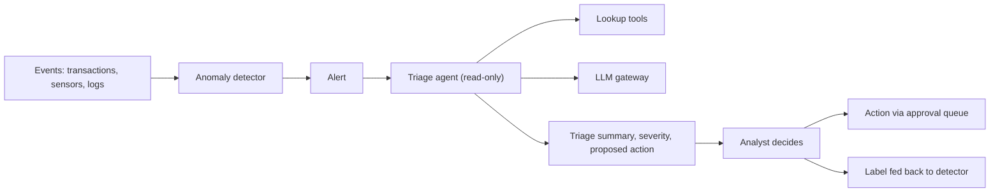

# Pattern: Anomaly Detection with Agent Triage

A detector (statistical or ML) flags unusual events. An agent gathers context, groups related alerts and proposes a next action for a human analyst.

| 5W1H | Answer |
|---|---|
| **Who** | Fraud, security operations, IT operations, plant reliability teams |
| **What** | Detection → enrichment by read-only tools → triage summary and proposed action → analyst decision |
| **When** | Alert volume is high and analysts spend time gathering context |
| **Where** | Detection in the data or ML platform; triage agent in layer 3 |
| **Why** | Analysts spend time on judgment rather than lookups |
| **How** | Agent has read-only scopes; actions go to an approval queue; outcomes feed back to the detector |

## When to use / not use

| Use when | Do not use when |
|---|---|
| Detector exists with known precision | No detector exists (build that first) |
| Context lives in several systems | Alerts need instant automated blocking (use rules) |

## Diagram

## Required controls by tier

| Control | Tier 1 | Tier 2 | Tier 3 |
|---|---|---|---|
| Agent tools read-only by default | Yes | Yes | Yes |
| Proposed actions need analyst approval | L3 within limits allowed | L3 limits by ARB | L2 |
| Detector model card and drift monitoring | Yes | Yes | Yes |
| Triage summary cites evidence it used | Yes | Yes | Yes |
| Alert content treated as untrusted (injection) | Yes | Yes | Yes |

## Evaluation approach

- Replay past alerts with known outcomes; measure summary accuracy and agreement of proposed action with analyst decision.
- Track time-to-triage and false-escalation rate in production.

## Anti-patterns

- Letting the agent close alerts as false positives without review.
- Ignoring analyst feedback, so the detector never improves.

## Illustrative examples

*Illustrative example (composite).* An energy company flags pressure anomalies on a pipeline segment. The agent pulls maintenance history and nearby sensor readings and proposes an inspection ticket.

*Illustrative example (composite).* A bank's fraud team gets a triage note per alert cluster with linked accounts and recent device changes. The analyst decides whether to contact the customer.
