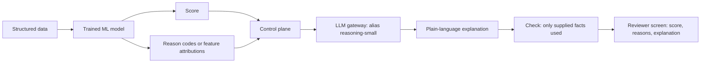

# Pattern: Classic ML with GenAI Explanation

A trained machine learning model makes the score or prediction. An LLM turns the model's output and reason codes into a plain-language explanation. The LLM never changes the score.

| 5W1H | Answer |
|---|---|
| **Who** | Staff who act on model scores (credit, fraud, demand, churn, maintenance) and the people they explain decisions to |
| **What** | ML model → score and reason codes → LLM explanation constrained to those facts |
| **When** | A reliable predictive model exists, but users struggle to understand or explain its output |
| **Where** | ML platform for the model; layers 3–5 for the explanation |
| **Why** | Keeps prediction where ML is strong and testable; uses the LLM for language only |
| **How** | Model card, explainability method (for example feature attributions), LLM prompt that may only use supplied facts |

For the 30 core algorithms and how architects should reason about them, see **The Architect's ML Playbook**: <https://edwardsuresh.github.io/architects-ml-playbook/>

## When to use / not use

| Use when | Do not use when |
|---|---|
| Structured data, clear target, measurable accuracy | You are tempted to ask an LLM to "predict" from tabular data |
| Explanations are needed for staff or customers | The model has no explainability output to ground on |

## Diagram

## Required controls by tier

| Control | Tier 1 | Tier 2 | Tier 3 |
|---|---|---|---|
| [Model card](../../01-governance/templates/model-card.yaml) | Yes | Yes | Yes |
| Model risk validation (if your organization has it) | Optional | Yes | Yes |
| Drift and performance monitoring | Yes | Yes | Yes |
| Fairness testing of the ML model | Recommended | Yes | Yes |
| LLM restricted to supplied facts; faithfulness check | Yes | Yes | Yes |
| Human makes the decision | — | Recommended | Yes (L2 max) |

## Evaluation approach

- ML model: holdout metrics, segment metrics, fairness measures, stability over time.
- Explanation: faithfulness (every claim traceable to a reason code), readability, no new facts, consistent across similar cases.

## Anti-patterns

- Letting the LLM "adjust" or second-guess the score.
- Explanations that cite factors the model did not use.
- Retraining the model without regenerating explanation tests.

## Illustrative examples

*Illustrative example (composite).* A bank's credit model gives a score and top factors. The LLM drafts a reviewer note and a customer-ready explanation that the officer edits.

*Illustrative example (composite).* A retailer's demand forecast explains to store planners why next week's forecast rose: promotion, weather pattern, local event, all from model features.
