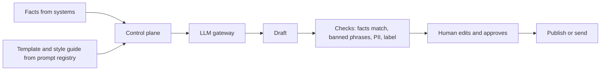

# Pattern: Content Generation

Drafts text (letters, summaries, product copy, reports, notes) for a human to review and approve.

| 5W1H | Answer |
|---|---|
| **Who** | Staff who write repetitive or structured content |
| **What** | Template plus facts plus style guide → draft → human edit and approval → publish |
| **When** | Content follows a known structure and the facts come from systems or documents |
| **Where** | Layers 3–5; publishing through existing content or correspondence systems |
| **Why** | Faster first drafts, more consistent tone |
| **How** | Registered prompts with style rules, facts passed in explicitly, labelling where required, human approval before external use |

## When to use / not use

| Use when | Do not use when |
|---|---|
| A human will read and own the final text | Output goes straight to customers with no review in a regulated context |
| Facts are supplied, not invented | The task needs original facts the model cannot know |

## Diagram

## Required controls by tier

| Control | Tier 1 | Tier 2 | Tier 3 |
|---|---|---|---|
| Human approval before external use | Yes | Yes | Yes |
| Facts check against supplied data | Recommended | Yes | Yes |
| AI-generated content label where required | Yes | Yes | Yes |
| Brand and regulatory phrase rules | Recommended | Yes | Yes |
| Copyright and IP check for external content | Yes | Yes | Yes |

## Evaluation approach

- Rubric scoring by reviewers (accuracy, tone, completeness, compliance).
- Automated checks: fact consistency with inputs, required clauses present, banned phrases absent.
- Production: edit distance, approval time, rejection reasons.

## Anti-patterns

- Rubber-stamp approval of drafts no one reads.
- Facts typed into the prompt from memory rather than pulled from systems.

## Illustrative examples

*Illustrative example (composite).* A hospital drafts discharge summaries from the clinical record for clinician review. Because it affects patient care, it is Tier 3 and the clinician signs every summary.

*Illustrative example (composite).* A manufacturer drafts product data sheets from engineering specifications. Product managers approve each sheet before release.
