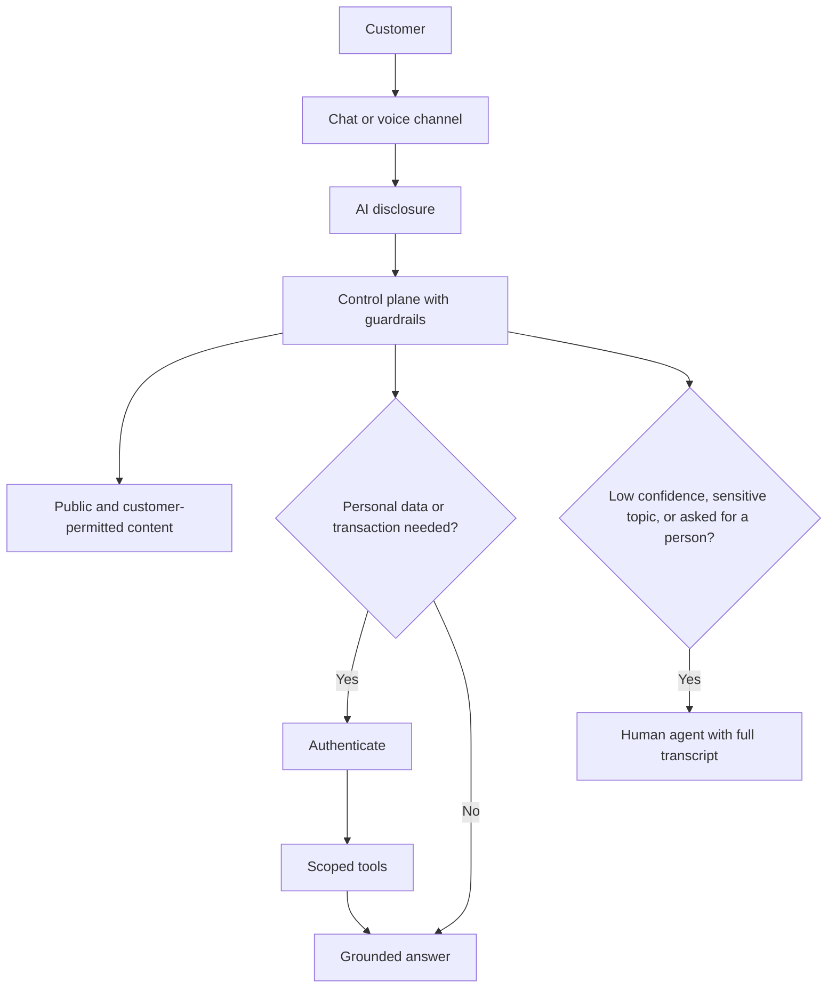

# Pattern: Conversational Customer Agent

A customer-facing chat or voice agent that answers, completes simple tasks and hands off to a human.

| 5W1H | Answer |
|---|---|
| **Who** | Customers, citizens, patients, members |
| **What** | Grounded answers plus a small set of authenticated tasks, with clear handoff |
| **When** | High volume of repeat enquiries with known answers or simple transactions |
| **Where** | Channels in layer 1; control plane, retrieval and tools in layers 3–4 |
| **Why** | Faster service around the clock; staff focus on complex cases |
| **How** | Disclose AI, authenticate before personal data, use tools for transactions, hand off on request or low confidence |

## When to use / not use

| Use when | Do not use when |
|---|---|
| Enquiries are repetitive and documented | Conversations are mostly distress, complaints or complex advice |
| A human team can take handoffs | There is no staffed fallback |

## Diagram

## Required controls by tier

| Control | Tier 1 | Tier 2 | Tier 3 |
|---|---|---|---|
| AI disclosure at start | Yes | Yes | Yes |
| Input and output guardrails | Yes | Yes | Yes |
| Authentication before personal data | — | Yes | Yes |
| Handoff with transcript on request | Yes | Yes | Yes |
| Sensitive-topic detection (vulnerability, complaints) routes to human | Recommended | Yes | Yes |
| No binding commitments outside approved tool results | Yes | Yes | Yes |
| Rate limits and abuse protection | Yes | Yes | Yes |

Customer-facing agents are normally Tier 2 or above.

## Evaluation approach

- Conversation scenarios, including adversarial and vulnerable-customer cases.
- Metrics: containment with resolution (not containment alone), handoff appropriateness, groundedness, policy violations, satisfaction.

## Anti-patterns

- Measuring success by containment alone, trapping customers.
- Agent promising refunds or terms it has no authority to give.
- No path to a person.

## Illustrative examples

*Illustrative example (composite).* A public agency's benefits agent answers eligibility questions from published guidance and books appointments. It never tells someone they are ineligible; that decision stays with caseworkers.

*Illustrative example (composite).* A retailer's agent tracks orders and starts returns after login, and hands off damaged-item complaints to staff.
