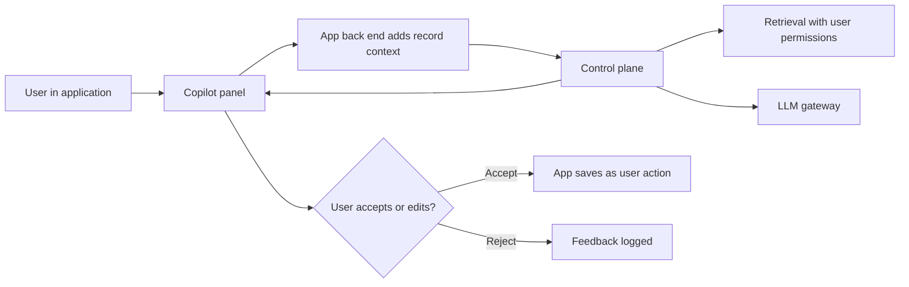

# Pattern: Copilot in App

AI assistance embedded inside an application staff already use (CRM, ERP, case management, IDE).

| 5W1H | Answer |
|---|---|
| **Who** | Staff working in a line-of-business application |
| **What** | Context-aware suggestions, summaries, drafts and lookups in the user's current screen |
| **When** | Users switch between the app and other tools to get information or write text |
| **Where** | Layer 2 integrates the UI; layers 3–5 do the work |
| **Why** | Adoption is higher when help appears where the work happens |
| **How** | Pass screen context and user identity to the control plane; return suggestions the user accepts or edits |

## When to use / not use

| Use when | Do not use when |
|---|---|
| Users spend a lot of time in one application | Users need a cross-system agent (use tool-using agent) |
| Help can be expressed as suggestion or draft | The vendor's embedded copilot already does it well (buy) |

## Diagram

## Required controls by tier

| Control | Tier 1 | Tier 2 | Tier 3 |
|---|---|---|---|
| Uses app's own authorization for context | Yes | Yes | Yes |
| AI content visibly marked until accepted | Yes | Yes | Yes |
| Acceptance and edit rates logged | Recommended | Yes | Yes |
| No automatic save of AI output | Recommended | Yes | Yes |
| Third-party questionnaire for embedded vendor copilots | If bought | If bought | If bought |

## Evaluation approach

- Scenario sets per screen or task; measure usefulness ratings and correctness.
- Production: acceptance rate, edit distance, time on task, feedback reasons.

## Anti-patterns

- Copilot that sees more data than the user can see in the app.
- Shipping without measuring whether suggestions are accepted.

## Illustrative examples

*Illustrative example (composite).* An energy company adds a copilot to its field-service app that summarizes asset history before a site visit.

*Illustrative example (composite).* A public agency adds case-summary drafting to its caseworker system. Caseworkers edit and save; nothing is saved automatically.
