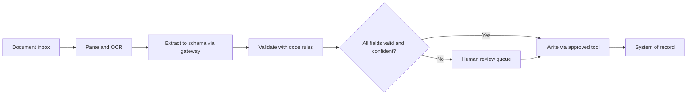

# Pattern: Document Extraction

Turns documents (forms, invoices, claims, letters, contracts) into structured, validated data.

| 5W1H | Answer |
|---|---|
| **Who** | Operations teams handling high document volumes |
| **What** | OCR or layout parsing, LLM extraction to a schema, validation, human review of exceptions |
| **When** | Documents arrive in many formats and staff re-key data |
| **Where** | Layers 3–5, with results written to systems of record through a tool |
| **Why** | Less re-keying, faster cycle time, fewer transcription errors |
| **How** | Parse, extract to a JSON schema, validate with code rules, route low-confidence fields to a human |

## When to use / not use

| Use when | Do not use when |
|---|---|
| Output can be described by a schema | Documents are fixed templates already handled by classic OCR rules |
| Errors can be caught by validation or review | No one can review exceptions |
| Volume justifies set-up | Volume is tiny |

## Diagram

## Required controls by tier

| Control | Tier 1 | Tier 2 | Tier 3 |
|---|---|---|---|
| Output schema with strict validation | Yes | Yes | Yes |
| Business validation in code, not prompt | Yes | Yes | Yes |
| Confidence thresholds route to human | Recommended | Yes | Yes |
| Field-level audit (source page and region) | Recommended | Yes | Yes |
| PII redaction in logs | If personal data | Yes | Yes |
| Write to system of record through approval queue | L3 allowed | L3 within limits | L2: human approves |

## Evaluation approach

- Labelled sample of documents per type, including poor scans and edge cases.
- Field-level precision and recall; document-level straight-through rate; error cost weighting for critical fields.
- Monitor human correction rate per field in production as a live eval.

## Anti-patterns

- Trusting free-text output without a schema.
- Letting the model decide whether a claim is valid (that is a decision, not extraction).
- No sampling of auto-approved documents.

## Illustrative examples

*Illustrative example (composite).* An insurer extracts claimant, policy number, incident date and damage description from claim forms and emails. Fields below threshold go to a handler.

*Illustrative example (composite).* A logistics firm extracts consignee, HS codes and weights from customs documents. Weight mismatches against the booking system trigger review.
