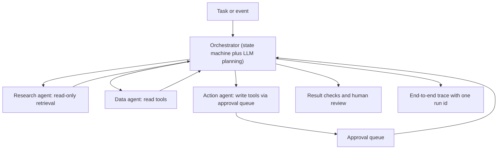

# Pattern: Multi-Agent Orchestration

An orchestrator coordinates several specialist agents, each with its own tools and scopes.

| 5W1H | Answer |
|---|---|
| **Who** | Teams automating long, multi-domain workflows |
| **What** | Orchestrator plans and delegates; specialist agents do bounded work; results are combined and checked |
| **When** | One agent would need too many tools or too broad permissions |
| **Where** | Layer 3 agent runtime; each agent is a separate non-human identity |
| **Why** | Keeps each agent's scope small and testable |
| **How** | Explicit workflow state, typed hand-offs, per-agent scopes, a global budget and step limit |

## When to use / not use

| Use when | Do not use when |
|---|---|
| Distinct domains with different data and permissions | A single tool-using agent can do it |
| Steps can be tested in isolation | You cannot trace or replay the whole run |
| Value justifies higher complexity | The team has not run a single agent in production yet |

## Diagram

## Required controls by tier

| Control | Tier 1 | Tier 2 | Tier 3 |
|---|---|---|---|
| Separate identity and scopes per agent | Yes | Yes | Yes |
| Workflow state held outside the LLM | Yes | Yes | Yes |
| Global step, time and cost limits | Yes | Yes | Yes |
| Typed hand-off schemas between agents | Recommended | Yes | Yes |
| Agent-to-agent messages treated as untrusted input | Yes | Yes | Yes |
| Human approval for writes | Per ARB | L3 limits | L2: every write |

## Evaluation approach

- Evaluate each agent alone, then the whole workflow end to end.
- Metrics: workflow success, steps per run, cost per run, loop rate, hand-off failures.
- Replay production traces in a sandbox after any change.

## Anti-patterns

- Agents chatting freely with no workflow state ("agent soup").
- One shared identity for all agents.
- No global budget, so loops run up cost.

## Illustrative examples

*Illustrative example (composite).* A logistics firm handles a delayed shipment: one agent reads tracking, one checks contract terms, one drafts the customer notice for approval.

*Illustrative example (composite).* An insurer's renewal workflow uses a research agent for risk data, a pricing-explanation agent over the rating model output, and a drafting agent for the broker letter. Underwriters approve.
