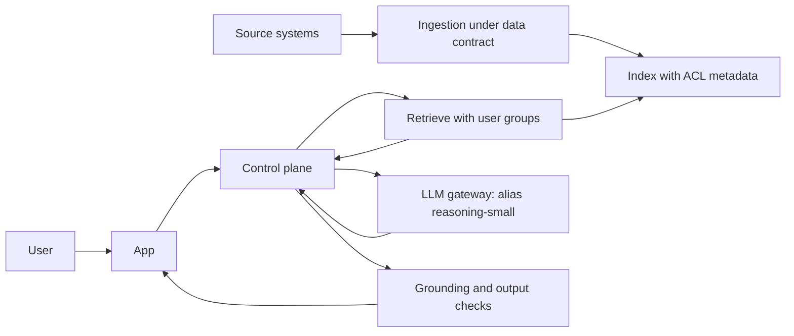

# Pattern: RAG Assistant

Answers questions from your own content, with citations, using retrieval-augmented generation.

| 5W1H | Answer |
|---|---|
| **Who** | Staff (or customers, see conversational agent) who need answers from policies, manuals, procedures, knowledge bases |
| **What** | Retrieve permitted passages, ground the model on them, answer with sources |
| **When** | The answer exists in documents you control and changes faster than you could retrain a model |
| **Where** | Layers 3 (control plane), 4 (ACL-aware retrieval) and 5 (gateway) |
| **Why** | Cuts search time and gives consistent answers traceable to a source |
| **How** | Ingest under a data contract, index with permissions, retrieve per user, generate with a registered prompt, check grounding |

## When to use / not use

| Use when | Do not use when |
|---|---|
| Content is written down and owned | The answer needs calculation or live transactional data (use a tool) |
| Users need sources to trust the answer | The decision is a regulated individual decision with no human review |
| Content changes often | Content has no owner or is of unknown quality |

## Diagram

## Required controls by tier

| Control | Tier 1 | Tier 2 | Tier 3 |
|---|---|---|---|
| Gateway and alias | Yes | Yes | Yes |
| Data contract for each source | Recommended | Yes | Yes |
| Retrieval filtered by user permissions | Yes if content is not public | Yes | Yes |
| Citations shown | Yes | Yes | Yes |
| Groundedness check before answer | Recommended | Yes | Yes, with refusal if below threshold |
| Injection guardrail on retrieved content | Recommended | Yes | Yes |
| Human review of answers | No | Sampled | Before any decision affecting a person |

## Evaluation approach

- Golden set of question, expected answer, expected sources (start with 50–100; grow from real queries).
- Metrics: retrieval hit rate, groundedness, answer correctness, citation accuracy, refusal when out of scope.
- Permission tests: a user without access must not get passages from restricted documents.
- Re-run on every change to prompt, model alias target, chunking or index.

## Anti-patterns

- **Permission-blind RAG:** one index, one service account, every user sees everything.
- **Helpful hallucination:** answering when retrieval found nothing.
- Indexing whole drives with no owner or freshness rule.
- Putting business rules in the prompt ("if the customer is gold tier, waive the fee").

## Illustrative examples

*Illustrative example (composite).* A bank gives branch staff a procedures assistant. Answers cite the procedure section and version. Staff in one country cannot retrieve another country's procedures.

*Illustrative example (composite).* A manufacturer gives maintenance engineers an assistant over equipment manuals and past work orders. When no manual covers the question, the assistant says so and suggests the right specialist team.
