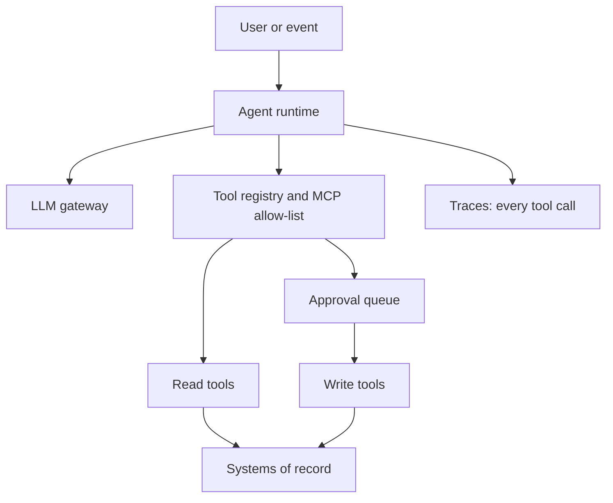

# Pattern: Tool-Using Agent

An agent that plans and calls approved tools (read and write) to complete a bounded task.

| 5W1H | Answer |
|---|---|
| **Who** | Staff who hand off multi-step tasks; operations teams |
| **What** | An LLM loop that selects tools from an allow-list, calls them through MCP, and returns a result or proposal |
| **When** | The task needs several lookups or updates across systems and follows a recognizable procedure |
| **Where** | Agent runtime in layer 3, tools in layer 4, models through layer 5 |
| **Why** | Removes swivel-chair work across systems |
| **How** | Non-human identity per agent, least-privilege scopes, write tools through the approval queue, step and cost limits |

## When to use / not use

| Use when | Do not use when |
|---|---|
| Steps vary by case and are hard to script | A fixed workflow or rules engine would do |
| Tools exist with clear contracts | Systems have no APIs and no owner for a tool |
| Actions are reversible or approvable | Actions are irreversible and high impact with no approval step |

## Diagram

## Required controls by tier

| Control | Tier 1 | Tier 2 | Tier 3 |
|---|---|---|---|
| Non-human identity, scopes in `agent-scopes.yaml` | Yes | Yes | Yes |
| MCP allow-list; no dynamic tool discovery in production | Yes | Yes | Yes |
| Max steps, max tokens, timeout | Yes | Yes | Yes |
| Write tools via approval queue | L4 with ARB approval | Within ARB limits (L3) | Human approves every write (L2) |
| Tool inputs validated by the tool, not the model | Yes | Yes | Yes |
| Every tool call traced | Yes | Yes | Yes |

## Evaluation approach

- Task scenarios with expected tool sequence and end state, run in a sandbox.
- Metrics: task success, wrong-tool rate, unnecessary-call rate, policy violations, cost per task.
- Adversarial cases: injected instructions in tool results, requests outside scope.

## Anti-patterns

- **Over-privileged agent:** one broad service account for all tools.
- Business rules written into the agent prompt instead of the tool.
- Letting the agent call tools it discovers at runtime.

## Illustrative examples

*Illustrative example (composite).* A retailer's agent handles a store's stock query: checks inventory, looks up transfers in transit, and proposes a transfer that the store manager approves.

*Illustrative example (composite).* A hospital's agent gathers bed status, discharge plans and transport bookings into a morning flow summary. It can read only; nurses make every change.
