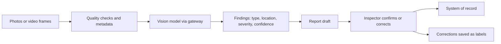

# Pattern: Vision-LLM Report

Images or video frames go in; structured findings and a readable report come out.

| 5W1H | Answer |
|---|---|
| **Who** | Inspectors, surveyors, adjusters, quality and maintenance teams |
| **What** | Image capture → vision-capable model or specialist vision model → structured findings → report draft → human review |
| **When** | Staff look at many photos and write similar reports |
| **Where** | Capture in layer 1 (mobile, cameras); processing in layers 3–5 |
| **Why** | Faster, more consistent inspection reports |
| **How** | Findings schema, confidence per finding, image region references, human confirmation |

## When to use / not use

| Use when | Do not use when |
|---|---|
| Findings can be listed in a schema | Safety-critical pass/fail with no human check |
| A trained specialist model exists, or images are varied enough to need general vision | A simple fixed-camera rule already works |

## Diagram

## Required controls by tier

| Control | Tier 1 | Tier 2 | Tier 3 |
|---|---|---|---|
| Findings schema and confidence | Yes | Yes | Yes |
| Faces and number plates blurred if not needed | If people in images | Yes | Yes |
| Image retention per data class | Yes | Yes | Yes |
| Human confirmation of findings | Recommended | Yes | Yes |
| Image quality gate (blur, lighting) | Recommended | Yes | Yes |

## Evaluation approach

- Labelled image set covering conditions (lighting, angle, damage types).
- Metrics: finding precision and recall by type, severity agreement, report accuracy.
- Production: inspector correction rate.

## Anti-patterns

- Accepting findings from poor-quality images.
- Sending images with people in them to endpoints not approved for personal data.

## Illustrative examples

*Illustrative example (composite).* An insurer's adjusters photograph vehicle damage; the system lists damaged parts and drafts the assessment for the adjuster.

*Illustrative example (composite).* A manufacturer inspects weld seams from line cameras; flagged seams go to a quality engineer with the image region marked.
