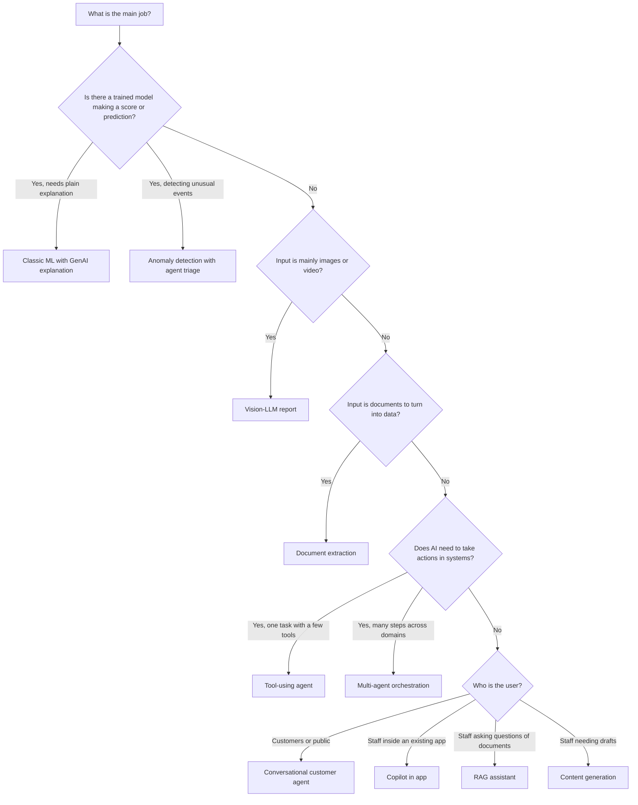

# Which Pattern When

| 5W1H | Answer |
|---|---|
| **Who** | Solution architects and delivery leads at intake |
| **What** | A decision flow to choose a starting pattern |
| **When** | Before filling the `pattern` field in the intake form |
| **Where** | Any use case |
| **Why** | The pattern sets the default controls, eval approach and risks |
| **How** | Walk the flow. Combine patterns where needed and record that in the ADR |

## Decision flow

## Quick table

| If you need to... | Start with | Often combined with |
|---|---|---|
| Answer questions from policies, manuals, knowledge bases | [RAG assistant](rag-assistant.md) | Copilot in app |
| Pull fields from forms, invoices, claims, letters | [Document extraction](document-extraction.md) | Tool-using agent (to file results) |
| Complete a task that needs lookups and updates | [Tool-using agent](tool-using-agent.md) | RAG assistant |
| Add AI to a CRM, ERP or case tool users already work in | [Copilot in app](copilot-in-app.md) | RAG, content generation |
| Run a long workflow with distinct specialist steps | [Multi-agent orchestration](multi-agent-orchestration.md) | Tool-using agent |
| Explain a credit, risk, demand or churn score | [Classic ML with GenAI explanation](classic-ml-with-genai-explanation.md) | Copilot in app |
| Triage alerts from sensors, transactions or logs | [Anomaly detection with agent triage](anomaly-detection-agent-triage.md) | Tool-using agent |
| Serve customers by chat or voice | [Conversational customer agent](conversational-customer-agent.md) | RAG, tool-using agent |
| Draft letters, summaries, product copy, reports | [Content generation](content-generation.md) | RAG |
| Inspect photos, scans or video frames | [Vision-LLM report](vision-llm-report.md) | Document extraction |

## Rule of thumb

Pick the simplest pattern that solves the problem. A RAG assistant at L0 is easier to govern than an agent at L3. Move up only when the value justifies the extra controls.
