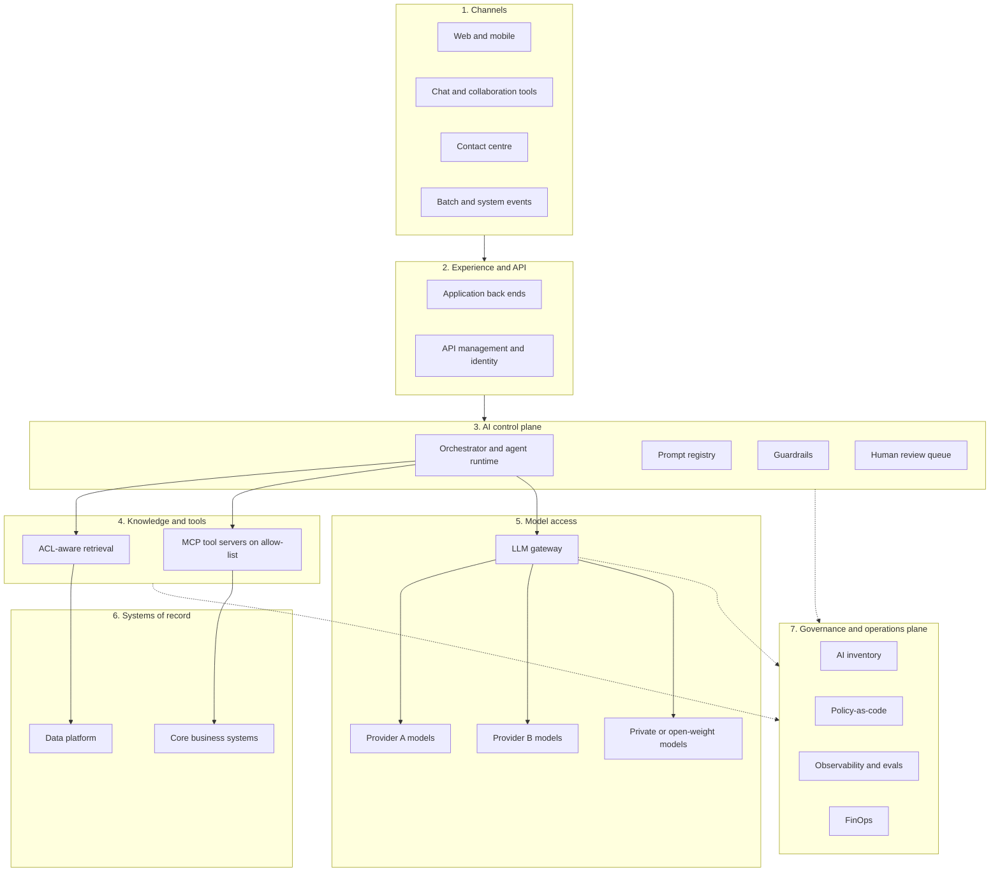
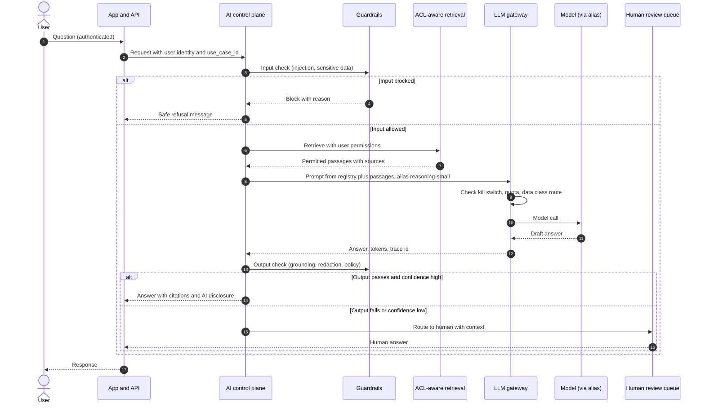

# Reference Architecture

Seven layers. Every AI use case uses the same control plane, gateway and governance plane, whatever cloud or model it runs on.

| 5W1H | Answer |
|---|---|
| **Who** | Enterprise architects, platform engineers, solution architects |
| **What** | The logical layers of an enterprise AI platform and how a request flows through them |
| **When** | Platform design (Day-0), or gap analysis against an existing AI estate (plug-in) |
| **Where** | Cloud-neutral; map layers to services with [cloud-mapping.md](../docs/cloud-mapping.md) |
| **Why** | Shared layers mean controls are built once and applied everywhere |
| **How** | Build or map each layer; route every model call through the gateway; record decisions as ADRs |

## The seven layers

| # | Layer | Purpose | Main components |
|---|---|---|---|
| 1 | **Channels** | Where users and systems meet AI | Web, mobile, chat tools, contact centre, email, batch jobs, other systems |
| 2 | **Experience and API** | Product logic, authentication, session, output handling | Application back ends, API management, identity, UI disclosure |
| 3 | **AI control plane** | Orchestration and policy for AI work | Orchestrator or agent runtime, prompt registry, guardrails, evaluation hooks, human review queue |
| 4 | **Knowledge and tools** | What AI can read and do | Retrieval (search, vector index) with ACL filtering, MCP tool servers on allow-lists, data contracts |
| 5 | **Model access (LLM gateway)** | Single door to every model | Alias routing, auth, quotas, caching, content safety, logging, cost tags, kill switch |
| 6 | **Systems of record** | Where business truth lives | Core systems, ERP, CRM, case management, data platform |
| 7 | **Governance and operations plane** | Cross-cutting control and visibility | AI inventory, policy-as-code, observability, FinOps, incident management, evaluation store |

## Architecture view

## Rules that hold across layers

1. **No direct model calls.** Every model call goes through the LLM gateway ([ADR-AI-001](adr/ADR-AI-001-llm-gateway.md)).
2. **Aliases, not model names.** Applications call aliases such as `reasoning-small`; the gateway maps them to approved models ([ADR-AI-002](adr/ADR-AI-002-model-aliases.md)).
3. **Retrieval honours source permissions.** The user's identity travels with the request.
4. **Tools through MCP on an allow-list**, with a non-human identity per agent and least-privilege scopes.
5. **Business rules stay in code or rules engines**, not in prompts.
6. **Everything is traced** with OpenTelemetry GenAI semantic conventions ([integration standards](standards/integration-standards.md)).
7. **There is always a human fallback** and a kill switch at the gateway.

## One guarded request, with human fallback

## Layer responsibilities by team

| Layer | Owner | Typical consumers |
|---|---|---|
| 1–2 | Delivery teams | Business users |
| 3 | Platform (runtime, registry, guardrails) and delivery (flows) | Delivery teams |
| 4 | Data owners (retrieval content) and platform (tool hosting) | Agents, assistants |
| 5 | Platform | All AI systems |
| 6 | System owners | Tools and retrieval |
| 7 | Platform, EA, risk, FinOps | Everyone |

## Day-0 vs plug-in

- **Day-0:** build layers 3, 5 and 7 first, then onboard the first use case.
- **Plug-in:** put the gateway (layer 5) in front of existing AI use, register systems in the inventory (layer 7), then retrofit guardrails and retrieval controls. See [rollout-plugin.md](../docs/rollout-plugin.md).
