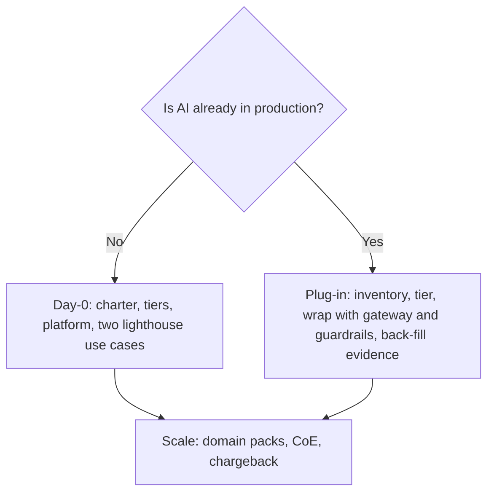

# The Architect's Enterprise AI Blueprint

**Move AI from scattered pilots to governed, multi-cloud production, in any industry.**

[](https://github.com/EdwardSuresh/architects-enterprise-ai-blueprint/actions/workflows/ci.yml)
[](https://github.com/EdwardSuresh/architects-enterprise-ai-blueprint/actions/workflows/evals.yml)
[](https://github.com/EdwardSuresh/architects-enterprise-ai-blueprint/actions/workflows/policy-gate.yml)

**Website:** https://edwardsuresh.github.io/architects-enterprise-ai-blueprint/ · Part of **The Architect's Series** with [The Architect's ML Playbook](https://edwardsuresh.github.io/architects-ml-playbook/).

## The blueprint in 5W1H

| | |
|---|---|
| **What** | A repo template, governance pack and Enterprise Architecture playbook for running AI as an enterprise capability |
| **Why** | Without one, every team picks its own model, logging and rules, and nobody can say how many AI systems exist, what they cost or who approved them |
| **Who** | Enterprise architects own it; platform teams run it; delivery teams build on it; risk, security and legal approve through it |
| **When** | **Day 0** if you have no AI in production; **plug-in** if you already do |
| **Where** | AWS, Azure or Google Cloud. Cloud-specific code lives only in `platform/adapters/` and `deploy/terraform/<cloud>/`. Sector rules live only in `domain-packs/` |
| **How** | Fork it, set `kit.yaml`, build from the patterns, and pass three CI gates: tests, evals and policy |

## Quick start (5 minutes, no cloud account)

```bash
git clone https://github.com/EdwardSuresh/architects-enterprise-ai-blueprint.git
cd architects-enterprise-ai-blueprint
pip install -e ".[test]"
pytest -q                                   # unit, integration and pack checks
python labs/02-rag/concept.py               # one guarded, permission-aware request
kit-evals --suite evals/suites/quality.yaml # evals gate
kit-policy-gate                             # governance gate on the AI inventory
```
Everything runs offline with a deterministic mock model. Real models plug in through `platform/adapters` (Microsoft Foundry / Azure OpenAI, Amazon Bedrock, Google Vertex AI, Claude API).

## What's inside

| Folder | Purpose |
|---|---|
| `00-strategy/` | AI strategy, capability map, use-case portfolio, value scorecard |
| `01-governance/` | Charter, RACI, risk tiers, **AI inventory**, policies, AI ARB, control maps (NIST AI RMF, ISO/IEC 42001, EU AI Act, OWASP LLM Top 10), templates |
| `02-architecture/` | Reference architecture, 10 patterns, which-pattern-when, standards, approved models, ADRs |
| `platform/core/` | Runnable Python package `kit`: LLM gateway, guardrails, permission-aware retrieval, prompt registry, conversation memory, tools with approval queue, orchestrator, tracing, evals, policy gate |
| `prompts/` | Prompt registry: versioned prompts with owner, linked eval set and change history |
| `platform/adapters/` | The only cloud-specific code |
| `platform/ml/` | Classic ML, linked to the 30 algorithms in The Architect's ML Playbook |
| `domain-packs/` | Overlays for 10 sectors plus a template for any other |
| `data/`, `security/` | Classification, data contracts, lineage; threat models, red-team set, agent identities |
| `finops/`, `ops/` | Budgets and cost model; SLOs, autonomy levels, incident and model-change runbooks |
| `labs/` | 6 building blocks × Concept / Build / Production (18 lab levels). Each block has a runnable `concept.py`; Build and Production steps are in its guide |
| `evals/`, `tests/` | Quality and safety suites; automated tests |
| `deploy/` | Docker, Kubernetes and Terraform module contracts per cloud |
| `enablement/` | Learning paths, champions network, workforce impact |
| `docs/` | Executive summary, maturity model, rollout plans, anti-patterns, cloud mapping, glossary, FAQ |
| `site/` | The public website (GitHub Pages) |

## Rollout


See `docs/rollout-day0.md` and `docs/rollout-plugin.md`.

## A note on examples

Organization examples throughout the blueprint (banks, insurers, retailers and so on) are **illustrative composites** based on common patterns. They are not client case studies. Real, client-approved case studies will be added to `case-studies/`.

## Licence

- Code: [MIT](LICENSE)
- Documentation and content: [CC BY 4.0](LICENSE-CONTENT.md)

Cloud service names and regulatory references change often. Verify against current provider documentation and your own legal counsel. Nothing here is legal advice. Please read the full [disclaimer](DISCLAIMER.md). Credits, referenced frameworks and third-party components are listed in [ACKNOWLEDGEMENTS.md](ACKNOWLEDGEMENTS.md). If you publish an adapted version, please give it a different name and credit the original, as CC BY 4.0 requires.

## About the author

**Rajaretnam Suresh Edward David** · Enterprise Architect · Oklahoma, USA · [LinkedIn](https://www.linkedin.com/in/sureshedward) · [GitHub](https://github.com/EdwardSuresh)

- TOGAF-certified Enterprise Architect with **25+ years in financial services**: banking, capital markets, insurance and energy.
- Depth in **architecture review boards and governance**, TOGAF ADM, reference architecture and application portfolio rationalization.
- **Hands-on AI architecture** with Microsoft Foundry (formerly Azure AI Foundry) and the Claude API.

I built this blueprint to show how I would stand up AI governance and a governed AI platform in a real enterprise, end to end: from the ARB and risk tiers down to running code and CI gates. Every design decision is recorded in `02-architecture/adr/`.

**Open to Enterprise Architect and Enterprise AI Architect roles.** I'm happy to walk through the blueprint with your team; [connect on LinkedIn](https://www.linkedin.com/in/sureshedward).
