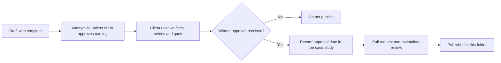

# Case Studies

**No client case studies are published yet.**

| 5W1H | Answer |
|---|---|
| **Who** | Practitioners who have adopted the kit, with their client's written approval |
| **What** | Factual accounts of adoption with honest lessons and agreed metrics |
| **When** | After at least one use case has run in production long enough to measure |
| **Where** | This folder, one file per case study |
| **Why** | Show how the kit works in practice |
| **How** | Use the template; get written client approval; open a pull request |

## About examples elsewhere in the kit

Organization examples throughout the kit (banks, insurers, hospitals, retailers, public agencies, manufacturers, logistics firms, energy companies) are **illustrative composites** based on common patterns. They are always labelled "Illustrative example". They are not client case studies and do not describe any specific organization.

## How a real case study gets added

1. Copy the template at [`01-governance/templates/case-study.md`](../01-governance/templates/case-study.md) to `case-studies/<slug>.md`.
2. Fill every field. Use only metrics with a known baseline and a method the client accepts.
3. Anonymize the client unless they approve being named.
4. Get **written client approval** for the full text, including any quote. Record the approval date and the approver's role in the file. Keep the approval evidence privately.
5. Open a pull request. Maintainers check that approval is recorded and that no confidential details remain.
6. Review or remove the case study by its expiry date, or when the client asks.

## Index

| Id | Sector | Adoption mode | Published |
|---|---|---|---|
| — | — | — | None yet |

## Reference runs

Before any client case study, this folder will hold **reference runs**: the author's own deployments of the labs on real cloud services, with measured results (eval pass rates, latency, cost per request) and screenshots. They show the kit working outside the offline mock model. Each run states the date, region, services and model versions used.
