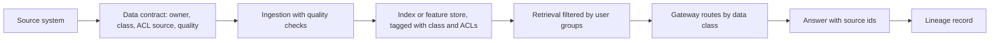

# Data

AI is only as trustworthy as the data it reads. This folder sets how data is classified, how each source used by AI is described in a contract, and how lineage is traced from source to answer.

| 5W1H | Answer |
|---|---|
| **Who** | Chief data officer, data owners, data engineers, privacy, AI delivery teams |
| **What** | Classification scheme, data contracts, lineage guidance |
| **When** | Before any data is indexed, sent to a model or used for training |
| **Where** | Applies to source data and every derived copy: chunks, embeddings, caches, prompt logs, eval sets |
| **Why** | AI multiplies copies of data. Each copy needs an owner, a class and the right access rules |
| **How** | Classify → contract → enforce at the gateway and retrieval layer → trace lineage |

## Contents

| Path | Purpose |
|---|---|
| [classification.yaml](classification.yaml) | Four data classes with allowed model hosting and retention |
| [contracts/](contracts/README.md) | Data contracts for AI data sources |
| [lineage/](lineage/README.md) | How to trace an answer back to its sources |

## Flow

## Rules in short

1. Derived data inherits the highest class of its sources.
2. The gateway only routes data to aliases approved for that class.
3. Every production AI data source has a contract with an `acl_source`.
4. When source data is deleted, derived copies are deleted too.

See the [data use policy](../01-governance/policies/data-use.md).
