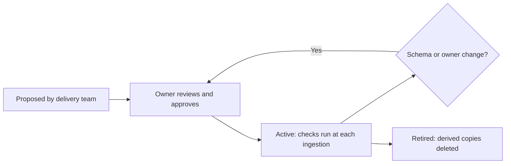

# Data Contracts for AI

A data contract is an agreement between the owner of a data source and the AI systems that use it. It says what the data is, who owns it, how fresh and good it must be, how it is classified and where its access rules come from.

| 5W1H | Answer |
|---|---|
| **Who** | Data owner (accountable), data engineer (maintains), AI delivery team (consumer) |
| **What** | One YAML file per source used in production by AI |
| **When** | Before a source is indexed or used for training in production; reviewed on schema change |
| **Where** | This folder, `<source-name>.yaml` |
| **Why** | Prevents unowned, stale or permission-blind data from feeding AI |
| **How** | Copy [example-policy-documents.yaml](example-policy-documents.yaml), fill each field, have the owner approve |

## Required fields

| Field | Meaning |
|---|---|
| `owner` | Named accountable person and team |
| `source` | System, location and extraction method |
| `schema` | Fields or document structure and metadata |
| `freshness` | How often updated; maximum acceptable lag |
| `quality_rules` | Checks that must pass for ingestion |
| `classification` | Data class from [classification.yaml](../classification.yaml) |
| `acl_source` | Where access permissions come from and how they are applied at retrieval |
| `consumers` | AI systems using this source (inventory ids) |
| `retention` | Derived data retention and deletion trigger |

## Lifecycle

## Failure handling

- Quality rule fails → ingestion stops for that batch; the index keeps the last good version; owner is alerted.
- Freshness breached → retrieval adds a "content may be out of date" flag; owner alerted.
- ACL sync fails → retrieval for affected documents is denied until fixed.
