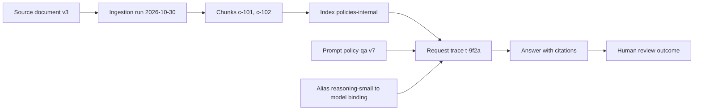

# Lineage for AI

Lineage answers: "Where did this answer come from?" For AI that means tracing from a response back through the model call, the prompt version, the retrieved chunks, the index, and the source documents and their versions.

| 5W1H | Answer |
|---|---|
| **Who** | Data engineers and platform team implement; auditors, risk and system owners use |
| **What** | Linked records from source to ingestion to index to retrieval to answer |
| **When** | Captured at ingestion and at every request |
| **Where** | Data catalog or governance tool for ingestion lineage; traces for request lineage |
| **Why** | Explains answers, supports complaints and audits, finds what to fix when a source is wrong |
| **How** | Ingestion emits lineage events; requests carry source ids in traces; both share ids |

## Two kinds of lineage

| Kind | Captured when | Key fields | Stored in |
|---|---|---|---|
| **Ingestion lineage** | Data is loaded into an index or feature store | source system, doc_id, version, contract_id, index name, chunk ids, ingestion run id, quality results | Data catalog or governance tool |
| **Request lineage** | Each AI request | trace_id, use_case_id, prompt id and version, model alias and model, retrieved chunk ids, tool calls, guardrail decisions, human review outcome | Observability traces (see [logging standard](../../02-architecture/standards/logging-standard.md)) |

## Joined view

## Minimum to implement

1. Give every chunk a stable id that includes `doc_id` and `version`.
2. Log retrieved chunk ids (not content) in the request trace.
3. Log `prompt.id`, `prompt.version` and `kit.model_alias` plus the resolved model.
4. Keep the ingestion run id on each chunk.
5. Be able to answer, for any `trace_id`: which documents, which versions, which prompt, which model.

## Uses

- **Complaint about an answer:** trace id → sources → owner fixes the document → re-index → re-run evals.
- **Source found wrong:** doc_id → all traces that used it in a period → decide whether affected people need contact.
- **Deletion request:** doc_id → all chunks, caches and logs to delete.
