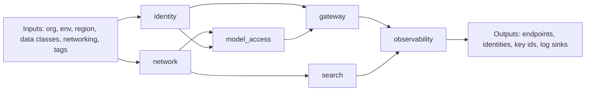

# Deploy

How the kit lands on a cloud. This folder defines **module contracts**: what each cloud's landing zone must provide and the inputs and outputs every module exposes. Same contract, three implementations, so the rest of the kit does not care which cloud it runs on.

| 5W1H | Answer |
|---|---|
| **Who** | Platform and cloud engineers |
| **What** | Module interface for Terraform per cloud, plus container and Kubernetes guidance |
| **When** | Day-0 landing zone build; adding a second cloud as an exit path |
| **Where** | `deploy/terraform/<cloud>/`, `deploy/docker/`, `deploy/k8s/` |
| **Why** | Cloud-specific infrastructure stays in one place; the platform code and governance stay portable |
| **How** | Implement the module contract for your cloud; outputs feed `kit.yaml`, `config/models.yaml` and the adapters |

## Layout

| Path | Contents |
|---|---|
| [terraform/aws/](terraform/aws/README.md) | AWS landing zone resources and contract |
| [terraform/azure/](terraform/azure/README.md) | Azure landing zone resources and contract |
| [terraform/gcp/](terraform/gcp/README.md) | Google Cloud landing zone resources and contract |
| [docker/](docker/README.md) | Container image guidance for the gateway and API |
| [k8s/](k8s/README.md) | Kubernetes deployment guidance |

This folder documents contracts only. It does not ship Terraform code; teams implement modules to the contract using their organization's standards.

## Module interface (all clouds)

Every cloud implementation exposes the same modules with the same input and output names. Cloud-specific extras are allowed but must be optional.

| Module | Purpose |
|---|---|
| `network` | Private networking, private endpoints, egress control |
| `identity` | Workload identities for gateway, agents and API; least-privilege roles |
| `secrets_keys` | Secret store and customer-managed keys |
| `model_access` | Access to foundation model services with private connectivity; per-alias deployments where the cloud requires them |
| `search` | Vector and keyword search service for retrieval |
| `gateway` | API management or gateway service in front of models |
| `runtime` | Container platform (Kubernetes or managed containers) for the kit services |
| `observability` | Logs, metrics, traces; OpenTelemetry collector endpoint |
| `data_governance` | Catalog and classification integration |
| `budgets` | Cloud budget alerts aligned to `finops/budgets.yaml` |

### Common inputs

| Input | Type | Description |
|---|---|---|
| `org_prefix` | string | Short name used in resource names |
| `environment` | string | `dev`, `test` or `prod` |
| `primary_region` | string | Main region |
| `allowed_regions` | list(string) | Regions allowed for restricted data (residency) |
| `data_classes_enabled` | list(string) | Which of public, internal, confidential, restricted this environment may process |
| `network_cidr` | string | Address range for the platform network |
| `enable_private_endpoints` | bool | Must be `true` if confidential or restricted is enabled |
| `log_retention_days` | number | Default metadata log retention (see logging standard) |
| `tags` | map(string) | Must include `cost_centre`, `owner`, `environment` |
| `model_aliases` | map(object) | Alias name → provider model or deployment settings |

### Common outputs

| Output | Description | Consumed by |
|---|---|---|
| `gateway_endpoint` | URL of the LLM gateway | Apps, `kit.yaml` |
| `model_endpoints` | Map alias → private endpoint or deployment name | `config/models.yaml` `cloud_bindings` |
| `search_endpoint` | Retrieval service endpoint | Retrieval adapter |
| `workload_identities` | Map service or agent → identity id | `security/identity/agent-scopes.yaml` |
| `key_ids` | Customer-managed key ids by data class | Storage and index configuration |
| `secret_store_uri` | Secret store location | Runtime |
| `otel_collector_endpoint` | Where to send traces | Tracing configuration |
| `log_sink_ids` | Destinations for metadata and content logs | Logging standard |

### Rules

1. If `restricted` is in `data_classes_enabled`, model endpoints must be private and in `allowed_regions`.
2. No long-lived keys are output; identities use workload identity federation.
3. All resources carry the `tags` input.
4. Outputs are the only coupling between deploy and the rest of the kit.
