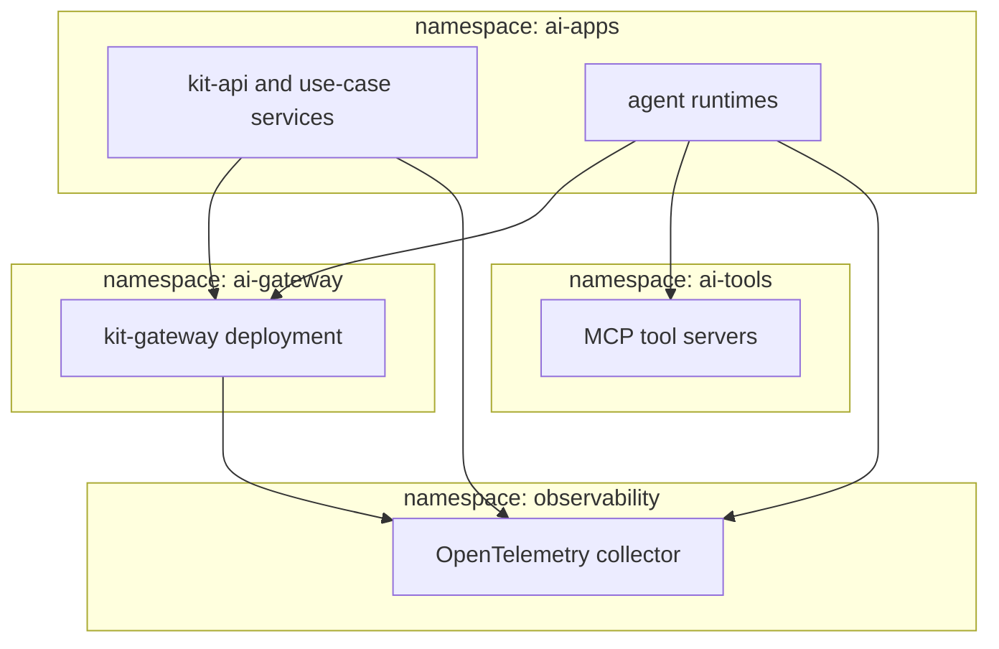

# Kubernetes

Guidance for running kit services on Amazon EKS, Azure Kubernetes Service or Google Kubernetes Engine.

| 5W1H | Answer |
|---|---|
| **Who** | Platform and SRE engineers |
| **What** | Namespaces, identity, networking, scaling and policy for kit services |
| **When** | When the `runtime` module is Kubernetes |
| **Where** | Any conformant cluster from the landing zone |
| **Why** | Same workload layout on every cloud |
| **How** | One namespace per tier of service; workload identity per service and agent; network policies deny by default |

## Layout

## Rules

| Area | Rule |
|---|---|
| Identity | Each deployment has its own Kubernetes service account bound to a cloud workload identity (EKS Pod Identity or IRSA, Entra Workload ID, GKE Workload Identity). One per agent |
| Network | Default-deny network policies. Only `ai-gateway` may egress to model endpoints. Only `ai-tools` may reach systems of record |
| Secrets | Use the cloud secret store via a CSI driver or external secrets operator; no secrets in manifests |
| Config | `config/models.yaml` and `kit.yaml` as ConfigMaps from versioned sources |
| Scaling | Horizontal autoscaling on request rate and latency for the gateway; at least two replicas across zones |
| Availability | Pod disruption budgets for the gateway; readiness probes |
| Policy | Admission policies: non-root, read-only root filesystem, signed images, resource limits |
| Kill switch | Gateway reads kill-switch state from a fast config source (for example a ConfigMap or feature flag service) without redeploy |
| Observability | OpenTelemetry collector as a deployment or daemonset; export to the cloud observability service |

## Release

- Use canary or progressive delivery for the gateway and agent runtimes.
- Model binding changes follow the [model version change runbook](../../ops/runbooks/model-version-change.md), not a cluster redeploy.
