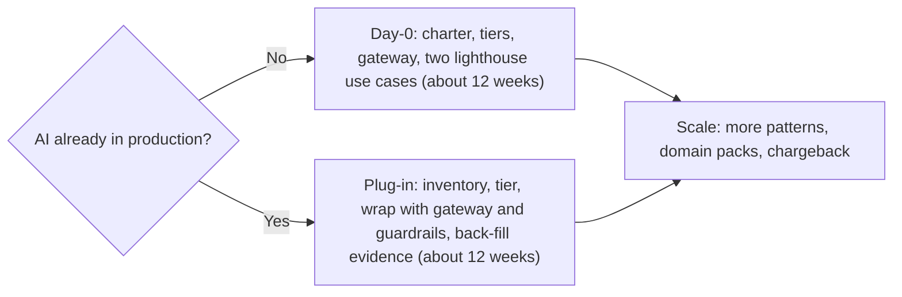

# Executive Summary

**The Architect's Enterprise AI Kit**: a cloud-neutral, industry-neutral way to run AI as a governed enterprise capability.

| 5W1H | Answer |
|---|---|
| **Who** | For CIOs, chief AI officers, heads of enterprise architecture, platform leaders, risk and compliance, and procurement |
| **What** | An open-source repo template, governance pack and architecture playbook |
| **When** | Day-0 if you have no AI in production; plug-in if you already do |
| **Where** | AWS, Azure, Google Cloud or on-premises; any sector |
| **Why** | To move from scattered pilots to production AI that is known, owned, controlled and measured |
| **How** | Adopt the governance, put a gateway in front of every model, build on shared patterns, and pass three gates: tests, evals and policy |

## 1. The problem

Most organizations now have AI in many places: pilots in business units, features switched on inside SaaS products, staff using public tools, and a few systems in production. Common symptoms:

- Nobody can say how many AI systems exist, who owns them or what they cost.
- Each team picks its own model, logging and rules.
- Pilots do not reach production, or reach it without proper controls.
- Vendors change models without notice and behaviour shifts.
- Risk and compliance teams review late, so they become a bottleneck.
- Regulation and standards (EU AI Act, ISO/IEC 42001, NIST AI RMF) ask for evidence that is hard to produce.

## 2. What the kit is

| Part | What it gives you |
|---|---|
| **Strategy** | Strategy template, capability map, use-case portfolio, value scorecard |
| **Governance** | Charter, RACI, four policies, AI architecture review board, risk tiers, AI inventory, impact assessments, control maps |
| **Architecture** | Seven-layer reference architecture, ten reusable patterns, integration and logging standards, decision records |
| **Platform code** | A small runnable package: LLM gateway, guardrails, permission-aware retrieval, tool approval queue, tracing, evals, policy gate |
| **Operations** | SLOs, autonomy levels, incident and model-change runbooks, FinOps budgets |
| **People** | Learning paths, champions network, workforce impact assessment |

Three ideas run through everything:

1. **One door to models.** Every model call goes through an LLM gateway, by alias. This gives one place for logging, cost, data rules and a kill switch.
2. **Risk-proportionate governance.** Low-risk work clears in days. High-risk work gets an impact assessment and full review.
3. **Evidence by default.** The inventory, decision log, eval reports and traces produce audit evidence as a side effect of normal work.

## 3. How it rolls out

| | Day-0 | Plug-in |
|---|---|---|
| Starting point | No AI in production | AI already running, often unmanaged |
| First move | Charter and platform foundation | Discover and inventory what exists |
| Main risk | Building platform without users | Disrupting live systems |
| Plan | [rollout-day0.md](rollout-day0.md) | [rollout-plugin.md](rollout-plugin.md) |

## 4. Maturity levels

| Level | Name | In one line |
|---|---|---|
| 1 | Ad hoc | AI use is scattered and largely unknown |
| 2 | Experimenting | Pilots exist; some rules; no shared platform |
| 3 | Defined | Shared platform, ARB, inventory and standards in place |
| 4 | Managed | Controls enforced automatically; value and risk measured |
| 5 | Optimized | Continuous improvement; AI governance is routine and fast |

Most organizations aim for Level 3 in the first year and Level 4 in the second. See the [maturity model](maturity-model.md).

## 5. Governance in brief

- **Intake** for every AI idea, bought or built.
- **Three risk tiers**, which set review depth and maximum autonomy (Tier 3 never above "act with approval").
- **AI ARB** inside your existing architecture governance, with fast-track for Tier 1.
- **AI inventory** as the system of record; a CI policy gate blocks entries that break the rules.
- **Control maps** to NIST AI RMF, ISO/IEC 42001, the EU AI Act and OWASP LLM Top 10.

## 6. What it costs to adopt (effort, not licence)

The kit is free and open source. The cost is people's time and your normal cloud spend.

| Role | Day-0 or plug-in (first ~12 weeks) | Ongoing |
|---|---|---|
| EA lead (ARB chair) | About half time | A few days per month |
| Platform engineers | Two to three people | One to two people for the platform |
| Risk, security, privacy | Part time for policy adaptation and first reviews | ARB attendance and reviews |
| Delivery team per lighthouse use case | A small cross-functional team | Normal product team |
| Program office | One coordinator | One coordinator |

These are planning ranges, not benchmarks. Adjust for your size.

## 7. Next steps

1. Run the [maturity self-assessment](maturity-model.md) with your leadership team (one session).
2. Choose Day-0 or plug-in.
3. Name an executive sponsor, ARB chair and platform owner.
4. Adapt the [charter](../01-governance/charter.md) and [policies](../01-governance/policies/).
5. Pick two lighthouse use cases from the [portfolio](../00-strategy/use-case-portfolio.csv) and start the 12-week plan.

## Limits

- Not legal advice. Your counsel decides how regulation applies.
- Cloud service names change; verify with [cloud-mapping.md](cloud-mapping.md) and your providers.
- Organization examples are illustrative composites, not case studies.

---

**Author:** Rajaretnam Suresh Edward David, TOGAF-certified Enterprise Architect with 25+ years in financial services, specializing in ARB governance, reference architecture and hands-on AI architecture.
