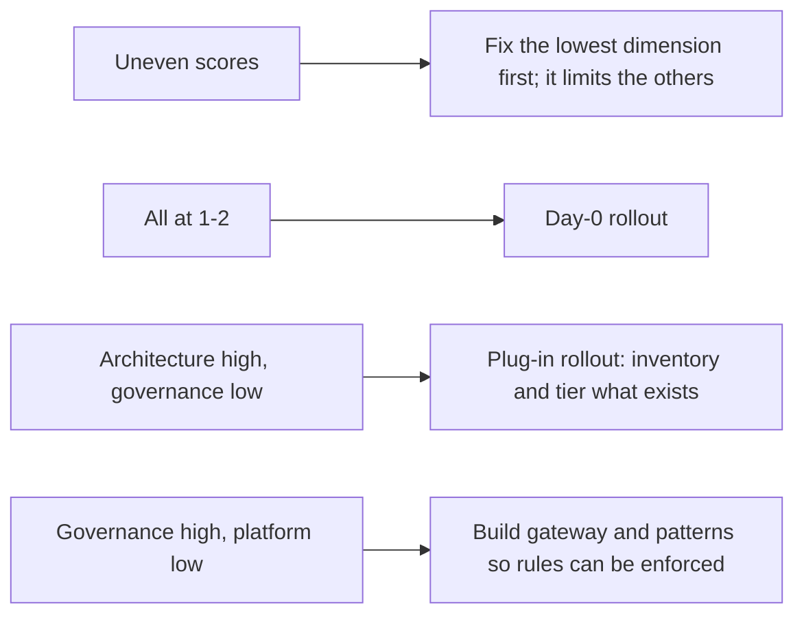

# AI Maturity Model

Eight dimensions, five levels. Use it to see where you are, choose where to go next, and track progress.

| 5W1H | Answer |
|---|---|
| **Who** | Leadership team, EA, platform, risk; facilitated by the AI program lead |
| **What** | A self-assessment across 8 dimensions × 5 levels |
| **When** | At program start; every six months after |
| **Where** | One workshop; results stored with the AI strategy |
| **Why** | Shows gaps honestly and sets realistic targets |
| **How** | Score each dimension by the highest level you fully meet; agree targets; link gaps to the roadmap |

## Levels

1 Ad hoc · 2 Experimenting · 3 Defined · 4 Managed · 5 Optimized

## Matrix

| Dimension | 1 Ad hoc | 2 Experimenting | 3 Defined | 4 Managed | 5 Optimized |
|---|---|---|---|---|---|
| **Strategy** | No AI strategy; activity driven by individuals | Strategy in draft; pilots chosen by enthusiasm | Approved strategy; portfolio scored with a common method | Portfolio reviewed quarterly; funding follows value | Strategy adapts from measured results; AI part of business planning |
| **Governance** | No rules; AI use largely unknown | Some guidance; reviews ad hoc | Charter, policies, ARB, tiers and inventory in place | Policy gate in CI; conditions tracked; control maps used for audit | Governance fast and routine; continuous assurance |
| **Architecture & platform** | Each team calls models directly | Some shared components; no standard | Reference architecture, LLM gateway, aliases, approved patterns | All calls through gateway; patterns reused; multi-provider fallback | Platform evolves from telemetry; new patterns added safely and quickly |
| **Data** | Unknown data in prompts and tools | Some classification; little ownership | Classification applied; data contracts for production sources | Permission-aware retrieval everywhere; lineage traceable | Data products designed for AI; quality issues caught upstream |
| **Security** | No AI-specific controls | Basic content filters | Threat models, guardrails, agent identities | Red teaming in CI; scopes reviewed; kill switch tested | Threat intelligence feeds tests; proactive hardening |
| **Operations** | No monitoring of AI behaviour | Basic uptime monitoring | SLOs, runbooks, traces with GenAI conventions | Quality SLOs and error budgets; model changes as releases | Self-healing where safe; incidents rare and learned from |
| **People & change** | No training; shadow AI common | Some enthusiasts and training | Learning paths by role; champions network | Literacy near universal; workforce impact assessed per use case | AI skills part of career paths; culture of safe experimentation |
| **Value & FinOps** | Costs and benefits unknown | Pilot costs tracked loosely | Budgets per use case; value baselines | Cost per transaction and value measured; chargeback | Portfolio optimized on value per cost; waste removed continuously |

## How to self-assess

1. **Prepare.** Share this page in advance. Ask each participant for evidence, not opinion.
2. **Score.** For each dimension, pick the highest level where *every* statement is true across most of the organization. If a level is only true for one team, it is not yet met.
3. **Evidence.** Note the evidence for each score (for example "inventory exists with 40 entries; 6 lack owners").
4. **Target.** Pick a target for each dimension for the next 6–12 months. Moving one level per dimension per year is a strong pace.
5. **Plan.** Turn each gap into roadmap items in the [AI strategy](../00-strategy/ai-strategy.md).
6. **Repeat.** Re-assess every six months.

## Scoring sheet

| Dimension | Current level | Evidence | Target level | Key gaps | Owner |
|---|---|---|---|---|---|
| Strategy | | | | | |
| Governance | | | | | |
| Architecture & platform | | | | | |
| Data | | | | | |
| Security | | | | | |
| Operations | | | | | |
| People & change | | | | | |
| Value & FinOps | | | | | |

## Reading the result

## Illustrative example

*Illustrative example (composite).* An energy company scored 3 on architecture (it had a gateway) but 1 on governance (no inventory) and 1 on value (no budgets). It chose the plug-in rollout, built its inventory in four weeks, and moved governance to 3 within two quarters.
