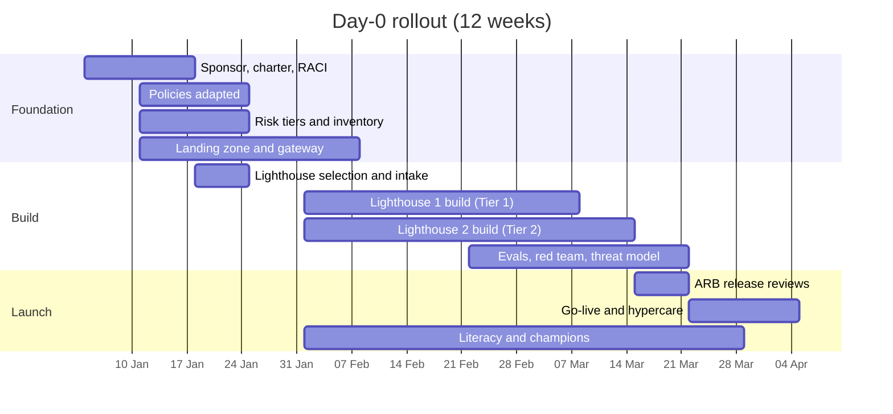

# Rollout: Day-0

For organizations with no AI in production (or only experiments). Twelve weeks to a governed platform and two lighthouse use cases live.

| 5W1H | Answer |
|---|---|
| **Who** | Executive sponsor, EA lead, platform team, risk and security, two lighthouse delivery teams |
| **What** | Foundation (governance and platform) plus two use cases in production |
| **When** | 12 weeks; then scale |
| **Where** | One cloud to start; the kit stays portable |
| **Why** | Starting with controls is cheaper than retrofitting them |
| **How** | Three phases: Foundation, Build, Launch |

## Plan

## Week by week

| Week | Governance | Platform | Use cases | People |
|---|---|---|---|---|
| 1 | Name sponsor, ARB chair, platform owner. Run maturity assessment | Choose cloud and landing zone design | Collect ideas into portfolio | Brief leaders |
| 2 | Adapt charter and RACI | Provision landing zone ([deploy](../deploy/README.md)) | Score with value scorecard | Plan all-staff literacy |
| 3 | Adapt four policies; set risk tiers | Deploy LLM gateway with two aliases | Select two lighthouses (one Tier 1, one Tier 2); intake forms | Recruit champions |
| 4 | First ARB (design reviews of lighthouses) | Observability with GenAI traces; kill switch | Data contracts for lighthouse sources | Literacy launches |
| 5 | Inventory live with policy gate in CI | Guardrails; permission-aware retrieval | Build starts | Builder path for delivery teams |
| 6 | Approved models list | Prompt registry; tool registry with approval queue | Lighthouse 1 first eval run | |
| 7 | Threat model review (Lighthouse 2) | FinOps tags and budgets | Golden sets grown with front-line experts | Reviewer path for human-in-the-loop staff |
| 8 | | SLOs defined | Lighthouse 1 pilot with small group | |
| 9 | Red-team results reviewed | Load and failover tests | Lighthouse 2 pilot; human queue tested | |
| 10 | ARB release review: Lighthouse 1 | Kill switch test | Lighthouse 1 go-live | Champions monthly call |
| 11 | ARB release review: Lighthouse 2 | | Lighthouse 2 go-live | |
| 12 | Quarterly ARB review; publish metrics | Hypercare ends | Baseline vs. after measures | Re-run maturity assessment |

## Exit criteria (end of week 12)

- Charter, policies, tiers and ARB operating.
- Inventory complete with owners; policy gate passing.
- Gateway in front of all model calls; kill switch tested.
- Two use cases in production with evals, SLOs, budgets and runbooks.
- Literacy started; champions in place.

## After week 12

Add use cases from the portfolio each quarter, adopt more patterns and domain packs, and move to chargeback as volume grows.
