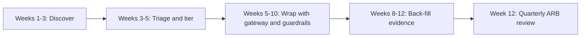

# Rollout: Plug-in

For organizations that already run AI, often in many places and without a common approach. Twelve weeks to bring existing AI under governance without stopping it.

| 5W1H | Answer |
|---|---|
| **Who** | Executive sponsor, EA lead, platform team, risk and security, owners of existing AI systems, procurement |
| **What** | Discover, inventory, tier, wrap with gateway and guardrails, back-fill evidence |
| **When** | 12 weeks; then continuous |
| **Where** | Existing clouds, SaaS products and internal tools |
| **Why** | You cannot govern what you cannot see; you should not break what already delivers value |
| **How** | Four phases: Discover, Triage, Wrap, Evidence |

## Plan

## Week by week

| Week | Discover and govern | Platform | Existing AI systems | People |
|---|---|---|---|---|
| 1 | Name sponsor, ARB chair. Maturity assessment. Announce an amnesty-style AI discovery | Review current model access paths | Survey teams; scan cloud bills, API keys, SaaS admin consoles for AI features | Brief leaders |
| 2 | Adapt charter and policies | Design gateway placement for existing traffic | Continue discovery; procurement lists vendors with AI features | Recruit champions to help discovery |
| 3 | Inventory draft with every system found | Deploy gateway in pass-through mode (logging only) | Owners named for each system | Literacy plan |
| 4 | Assign risk tiers; flag Tier 3 systems | Route first systems through gateway | Tier 3 systems: start impact assessments | Literacy launches |
| 5 | First ARB: Tier 3 and highest-risk Tier 2 | Aliases mapped to current models | Vendor questionnaires sent | |
| 6 | Decide: continue, condition or stop for each Tier 3 system | Turn on gateway quotas, budgets and kill switch | Migrate direct model calls to gateway, one system at a time | |
| 7 | Policy gate in CI on the inventory | Guardrails added in front of customer-facing systems | Permission checks on existing RAG indexes | Reviewer training for human-in-the-loop staff |
| 8 | | GenAI tracing standardized | Golden sets built for top systems; first evals run | |
| 9 | Threat model reviews for Tier 2+ | | Red-team runs | |
| 10 | | All Tier 2+ traffic through gateway | Fix findings; SLOs set | Champions monthly call |
| 11 | System cards and decision log back-filled | FinOps showback report | Runbooks adapted; kill switch tested | |
| 12 | Quarterly ARB review; publish inventory metrics | | Retire orphaned systems | Re-run maturity assessment |

## Rules during plug-in

- **Do not break production.** Start the gateway in logging-only mode; switch on enforcement per system after testing.
- **Highest risk first.** Tier 3 and customer-facing systems get attention in weeks 3–6.
- **No blame.** Discovery depends on people declaring what they use.
- **Stop only with cause.** A system is stopped early only if it creates clear, current harm or breaks a prohibited-use rule.

## Exit criteria (end of week 12)

- Inventory covers all known AI systems with owners and tiers.
- All Tier 2 and Tier 3 model traffic goes through the gateway; kill switch tested.
- Tier 3 systems have impact assessments and ARB decisions.
- Evals and red-team results exist for the top systems.
- Orphaned systems retired or given owners.
