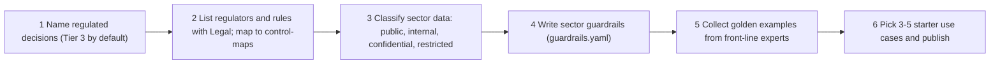

# Domain Packs

A domain pack is a sector overlay. The core kit (strategy, governance, platform, operations) works the same in every industry. A pack adds what changes by sector: the regulated decisions, the regulators, the sensitive data, the guardrail rules and the test examples.

| 5W1H | Answer |
|---|---|
| **Who** | Sector business owners, compliance and legal, risk, data owners, EA and the AI platform team |
| **What** | Ten starter packs plus a template. Each holds use cases, regulations, guardrails, golden evals and data contracts |
| **When** | When a business unit in a sector starts its first AI use case, and at each annual review |
| **Where** | `domain-packs/<sector>/`, loaded by `kit.guardrails` and `kit.evals` from `platform/core/kit` |
| **Why** | Generic AI controls miss sector rules. Packs make sector risk visible and testable without forking the kit |
| **How** | Copy a pack (or `_template`), follow the six-step overlay method below, and send each use case through governance intake |

## What is in every pack

| File | Purpose | Used by |
|---|---|---|
| `README.md` | 5W1H, starter use cases, data classes, what AI must never do | People |
| `regulations.md` | Sector rules mapped to kit controls | Legal, compliance, ARB |
| `use-cases/<slug>/spec.md` | Three starter use case specs | Product owners, architects |
| `guardrails.yaml` | Sector rules (`block_topic`, `require_human`) | `kit.guardrails` |
| `evals/golden.jsonl` | Starter golden examples | `kit.evals` |
| `data-contracts/README.md` | Data sources, owners, classes, ACL sources | Data owners, `kit.retrieval` design |

## The six-step overlay method

This method works for any sector, including ones not listed here.



1. **Name the regulated decisions.** List the decisions that affect people's money, health, safety, legal rights or access to services. Examples: credit approval, claim denial, benefit eligibility, permit to work, product release. Any AI use that feeds these decisions starts at **Tier 3** by default.
2. **List sector regulators and rules with Legal.** Write them in `regulations.md`. Say in one or two sentences what each means for AI. Map each to the kit's control-maps in [01-governance](../01-governance/).
3. **Classify sector data into the kit's four classes.** Use public, internal, confidential and restricted. Name the sector data types (for example PHI, CPNI, export-controlled technical data) and give each a class.
4. **Write sector guardrails.** Put 3-5 rules in `guardrails.yaml`. Use `block_topic` for things AI must never discuss or do. Use `require_human` for things a person must handle. Test the rules so they do not fire on normal answers.
5. **Collect golden examples from front-line experts.** The starter packs have six examples each. In real use, aim for **100-300 examples per use case**, written or checked by the people who do the work today. Include edge cases and questions where the right answer is "not covered".
6. **Pick 3-5 starter use cases and publish.** Write a spec for each. Start with one low-risk internal Q&A use case. Send each through governance intake. Publish the approved list so teams know what is allowed.

## Packs

| Pack | Example regulated decisions | Example rules covered | Starter specs |
|---|---|---|---|
| [_template](_template/) | (placeholders) | (placeholders) | Example use case |
| [financial-services](financial-services/) | Credit approval, SAR filing, client communications | SR 11-7, ECOA/Reg B, GLBA, FINRA/SEC, DORA | Policy Q&A, complaint triage, credit memo drafting |
| [insurance](insurance/) | Underwriting, rating, claim denial | NAIC AI Model Bulletin, unfair trade practices, Colorado SB21-169 | Underwriting manual Q&A, FNOL summary, claim letters |
| [supply-chain](supply-chain/) | PO changes, payments, export classification | EAR, ITAR, sanctions, customs, contract terms | PO exceptions, contract Q&A, delay briefing |
| [oil-and-gas](oil-and-gas/) | Integrity repairs, permits to work, reportability | PHMSA, OSHA PSM, EPA reporting, API, IEC 62443 | Drilling report summary, HSE Q&A, work order triage |
| [retail](retail/) | Refunds, pricing, product claims | PCI DSS, FTC Act Section 5, CCPA/CPRA, ADA/WCAG | Customer chat, product descriptions, associate Q&A |
| [healthcare](healthcare/) | Diagnosis, treatment, coverage decisions | HIPAA, FDA AI-enabled software guidance, ONC HTI-1 | Documentation draft, patient messages, policy Q&A |
| [public-sector](public-sector/) | Eligibility, benefits, licensing, enforcement | OMB AI memoranda, Section 508, records laws | Constituent chat, case summary, records triage |
| [telecom-utilities](telecom-utilities/) | Disconnection, grid or network operations | CPNI, NERC CIP, state commissions | Care agent assist, outage comms, field assistant |
| [manufacturing](manufacturing/) | Product release, NCR disposition, safety reporting | Product safety, ISO 9001 records, export controls, IEC 62443 | NCR routing, SOP Q&A, troubleshooting |
| [professional-services](professional-services/) | Opinions, sign-offs, conflict clearance | Client confidentiality, professional conduct, IP | Precedent search, proposals, document review |

## File formats the code depends on

`kit.guardrails` and `kit.evals` parse these files. Keep the keys exactly as shown.

**guardrails.yaml**

```yaml
pack: <pack-slug>
rules:
  - id: <SECTOR-G01>
    description: <text>
    type: block_topic        # or require_human
    patterns: ['\bregex one\b', 'regex two']   # Python regex, case-insensitive, checked on input and draft output
    message: <what the user sees>
```

**evals/golden.jsonl** (one JSON object per line)

```json
{"id": "FS-001", "input": "user question", "context": "source text", "expected_keywords": ["phrase"], "forbidden": ["phrase"]}
```

- Every `expected_keywords` item must appear in that line's `context` (case-insensitive).
- No `forbidden` item may appear in the `context` or `input`.
- Use 2-3 expected keywords and 1-2 forbidden phrases per line.

## Notes

- All organizations, policies and numbers in the packs are fictitious. Illustrative example only.
- Regulation lists are starting points. Not legal advice; confirm with counsel and current regulator guidance.
- A use case that spans sectors (for example a bank's supply chain) loads both packs.
