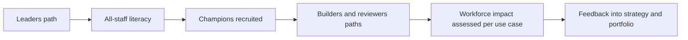

# Enablement

Technology is the easy part. People need to know how to use AI well, how to build it safely, how to review it, and how their work will change.

| 5W1H | Answer |
|---|---|
| **Who** | Chief AI officer, HR, learning teams, champions, managers |
| **What** | Learning paths by role, a champions network, workforce impact assessment |
| **When** | Literacy before broad AI tool rollout; builder and reviewer paths before those roles start work |
| **Where** | Existing learning platforms; champions in every business unit |
| **Why** | Adoption, safe use and trust depend on people, and some regulation expects AI literacy |
| **How** | Assign paths by role, track completion, run the champions network, assess workforce impact for changing roles |

## Contents

| File | Purpose |
|---|---|
| [learning-paths.md](learning-paths.md) | Four paths: all staff, builders, reviewers, leaders |
| [champions-network.md](champions-network.md) | How to set up and run AI champions |
| [workforce-impact-assessment.md](workforce-impact-assessment.md) | Template for assessing changes to roles and tasks |

## Sequence

