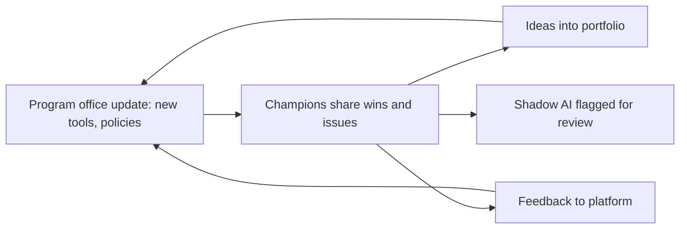

# AI Champions Network

| 5W1H | Answer |
|---|---|
| **Who** | Volunteers or nominated staff in each business unit, coordinated by the AI program office |
| **What** | A network that spreads good AI practice, gathers ideas and feedback, and spots shadow AI |
| **When** | Start alongside all-staff literacy; meet monthly |
| **Where** | Every business unit and major location |
| **Why** | Central teams cannot reach everyone. Peers are trusted and know local work |
| **How** | Recruit, train, give time and recognition, connect to the portfolio and ARB |

## Role of a champion

- Help colleagues use approved AI tools well.
- Collect use-case ideas and help submit [intake forms](../01-governance/arb/intake-form.yaml).
- Share feedback on tools and guardrails with the platform team.
- Point people to the right policy or channel.
- Flag unapproved AI tools in use, without blame, so they can be reviewed.

A champion is **not** an approver and does not replace the ARB.

## Set-up

| Step | Action |
|---|---|
| 1 | Aim for roughly one champion per team or department, covering every business unit |
| 2 | Ask managers to agree a small, regular time allowance |
| 3 | Champions complete all-staff literacy plus a champion module (tools, intake, policies, how to coach) |
| 4 | Create a shared channel and a monthly call |
| 5 | Give early access to new tools and features |
| 6 | Recognize contributions in performance conversations |

## Monthly rhythm

## Measures

- Coverage: business units with an active champion.
- Ideas submitted through champions.
- Adoption of approved tools in champion areas.
- Shadow AI items found and resolved.

## Illustrative example

*Illustrative example (composite).* A manufacturer named champions on every shift at three plants. Within a quarter, champions surfaced a dozen intake ideas, two of which became production use cases, and helped move teams off an unapproved transcription tool onto an approved one.
