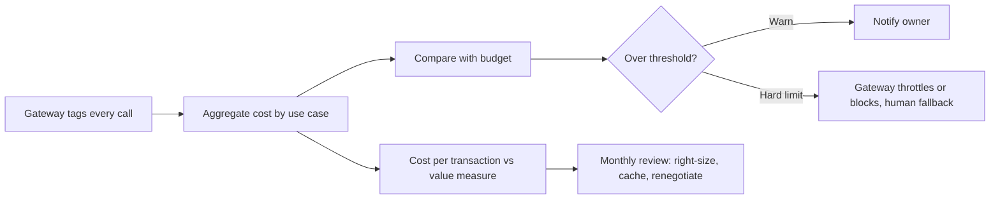

# FinOps for AI

AI cost is usage-based and grows quietly. FinOps makes cost visible per use case, sets budgets, and links cost to value.

| 5W1H | Answer |
|---|---|
| **Who** | FinOps lead, platform team, use-case owners, finance partner |
| **What** | Budgets and alerts per use case, cost model, tagging and chargeback |
| **When** | Budget set before release; reviewed monthly; re-forecast quarterly |
| **Where** | Gateway cost tags, cloud billing, FinOps dashboards |
| **Why** | Prevents "token blind spend" and lets you compare cost with value |
| **How** | Every call tagged with `use_case_id`; budgets enforced at the gateway; monthly review against the value scorecard |

## Contents

| File | Purpose |
|---|---|
| [budgets.yaml](budgets.yaml) | Monthly budgets and alert thresholds per use case |
| [cost-model.md](cost-model.md) | Cost per transaction, tagging, chargeback, caching, right-sizing |

## Monthly cycle

## Key measures

- Cost per transaction (per answer, per document, per case).
- Cost per unit of value (for example cost per minute saved).
- Share of spend by model alias.
- Cache hit rate.
- Budget variance by use case.
