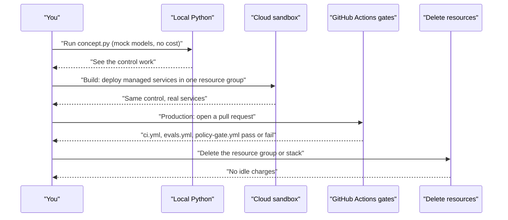

# Labs

There are 18 hands-on labs: six building blocks, each at three levels. You start with plain Python on your laptop. You end with governed cloud services and CI gates that produce audit evidence.

| 5W1H | Answer |
|---|---|
| **Who** | Architects, engineers and tech leads learning to build governed enterprise AI. No cloud account is needed for the Concept level |
| **What** | 6 building blocks × 3 levels = 18 labs: Concept (plain Python), Build (real cloud services), Production (governance, CI, evidence) |
| **When** | Work through them in order. Allow one or two sessions per lab at each level |
| **Where** | This repo. Concept runs locally. Build uses a sandbox subscription or account. Production uses GitHub Actions |
| **Why** | Each block is a control that every enterprise AI system needs. Building them yourself shows how the controls fit together |
| **How** | Run `concept.py`, rebuild the same idea on one cloud, then add the governance evidence and CI gate |

## The three levels

| Level | What you use | What you prove | Cost |
|---|---|---|---|
| **Concept** | Plain Python and the `kit` package (`platform/core/kit`). Mock models, no cloud | You understand the control and can explain it | Free |
| **Build** | Real cloud services. Azure is the reference implementation. AWS and Google Cloud equivalents are given | The control works with managed services | Small (see budget guard) |
| **Production** | Governance files, golden sets, GitHub Actions gates | The control is enforced and leaves evidence | Free on public repos (check GitHub Actions limits for private repos) |

## The six building blocks

| Lab | Building block | Business case (Illustrative example) | Kit module |
|---|---|---|---|
| [01-llm-gateway](01-llm-gateway/) | LLM gateway | A bank routes all model calls through one gateway | `kit.gateway` |
| [02-rag](02-rag/) | Permission-aware RAG | An insurer's underwriting manual Q&A | `kit.retrieval` |
| [03-guardrails](03-guardrails/) | Guardrails | A retailer's customer chat | `kit.guardrails` |
| [04-tool-agent-mcp](04-tool-agent-mcp/) | Tool-using agent and MCP | Supply-chain PO exceptions | `kit.tools` |
| [05-evals](05-evals/) | Golden-set evals | Oil and gas daily drilling report summary | `kit.evals` |
| [06-governance](06-governance/) | Governance as code | Any organization's AI inventory and ARB | `kit.policy_gate` |

`kit.tracing` runs under all of them and records spans for audit.

## Setup

From the repo root:

```bash
python -m venv .venv && source .venv/bin/activate   # Windows: .venv\Scripts\activate
pip install -e .
python labs/01-llm-gateway/concept.py
```

Add `pip install -e ".[azure]"`, `".[aws]"` or `".[gcp]"` when you reach the Build level. Copy `.env.example` to `.env` for cloud settings. Never commit `.env`.

## How a lab session flows



## Progress checklist

| Lab | Concept | Build | Production |
|---|---|---|---|
| 01 LLM gateway | [ ] | [ ] | [ ] |
| 02 RAG | [ ] | [ ] | [ ] |
| 03 Guardrails | [ ] | [ ] | [ ] |
| 04 Tool agent and MCP | [ ] | [ ] | [ ] |
| 05 Evals | [ ] | [ ] | [ ] |
| 06 Governance | [ ] | [ ] | [ ] |

Copy this table into your own notes or a GitHub issue and tick boxes as you go.

## Sandbox budget guard

The labs are designed to stay **under about $50 in total** for the Build level. That only holds if you follow these rules.

1. **Use free tiers where they exist.** Examples: Azure AI Search Free tier, Azure AI Content Safety F0. AWS and Google Cloud have their own free tiers and trial credits.
2. **Use small pay-per-token model deployments.** Pick the smallest model that does the job. Use standard pay-as-you-go deployments, not provisioned throughput.
3. **Set a budget alert before you create anything.** Azure Cost Management budgets, AWS Budgets, or Google Cloud Billing budgets. Set alerts at 50%, 80% and 100% of your limit.
4. **Put every lab resource in one resource group, stack or project.** Tag it `lab=<number>`.
5. **Delete the resource group (or stack, or project) at the end of each session.** Some services charge per hour even when idle.
6. **Watch for services with a minimum charge.** Some vector stores, gateways and search tiers bill by the hour regardless of use. Each lab calls these out.
7. **Check current pricing before you start.** Prices, free tier limits and tier names change. The cloud provider's pricing page and calculator are the source of truth, not this README.

```bash
# Azure: one resource group per session, deleted at the end
az group create -n rg-aikit-lab01 -l eastus2 --tags lab=01
# ... do the lab ...
az group delete -n rg-aikit-lab01 --yes --no-wait
```

## CI gates used by the Production level

| Workflow | What it gates |
|---|---|
| `.github/workflows/ci.yml` | Unit tests (`pytest -q`), domain pack structure, and every `concept.py` |
| `.github/workflows/evals.yml` | Golden-set quality suite (`kit-evals --suite evals/suites/quality.yaml`); fails below threshold |
| `.github/workflows/policy-gate.yml` | AI inventory against risk tiers and approved models (`kit-policy-gate`) |

## A note on cloud service names

Cloud AI services are renamed often. For example, Azure AI Foundry is now Microsoft Foundry. If a name in a lab no longer matches the console, search the provider's docs for the capability (for example "token rate limit policy" or "prompt injection filter").

Author: Rajaretnam Suresh Edward David.
