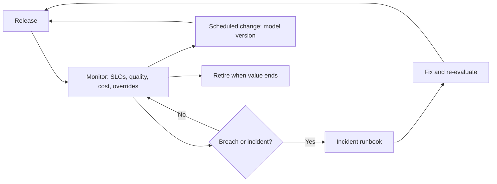

# Operations

Running AI is different from running ordinary software: behaviour can change without a code change, quality degrades quietly, and costs scale with use. This folder holds SLOs, runbooks and autonomy levels.

| 5W1H | Answer |
|---|---|
| **Who** | Platform SRE, use-case on-call, system owners, risk and ARB for incidents |
| **What** | SLOs, autonomy levels, incident, model change and retirement runbooks |
| **When** | From the first production release, for as long as the system runs |
| **Where** | Gateway, control plane, observability platform, incident tooling |
| **Why** | So AI systems are reliable, stoppable and changed safely |
| **How** | Monitor SLOs; use the kill switch and human fallback in incidents; treat every model change as a release |

## Contents

| File | Purpose |
|---|---|
| [slo.yaml](slo.yaml) | Service level objectives for platform and use cases, including quality SLOs |
| [autonomy-levels.md](autonomy-levels.md) | L0–L4 and maximum per tier |
| [runbooks/ai-incident.md](runbooks/ai-incident.md) | Detect, stop, fall back, fix, re-enable |
| [runbooks/model-version-change.md](runbooks/model-version-change.md) | Changing what an alias points to |
| [runbooks/model-retirement.md](runbooks/model-retirement.md) | Retiring a model or an AI system |

## Operating loop

## What makes AI ops different

| Concern | Classic software | AI systems |
|---|---|---|
| Change trigger | Code deploy | Code, prompt, model binding, vendor update, data change |
| Failure signal | Errors, latency | Also wrong but fluent answers, drift, rising overrides |
| Stop mechanism | Rollback | Kill switch at gateway plus human fallback |
| Testing | Unit and integration | Plus eval suites and red-team sets |
