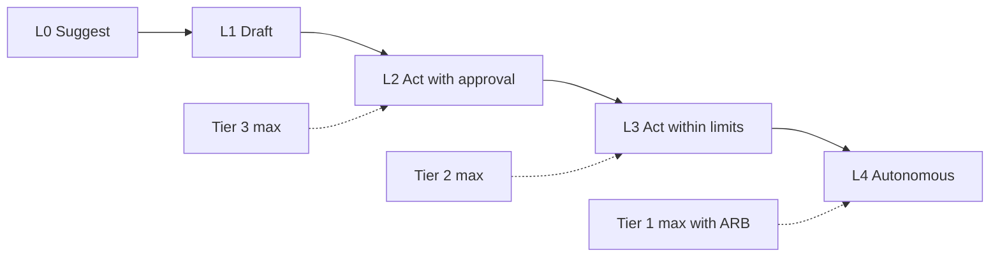

# Autonomy Levels

How much an AI system may do without a human. Every AI system declares one level in the AI inventory. The policy gate checks it against the risk tier.

| 5W1H | Answer |
|---|---|
| **Who** | System owners declare; ARB approves; policy gate checks |
| **What** | Five levels from L0 Suggest to L4 Autonomous, with a maximum per tier |
| **When** | Set at intake; changing level is a material change needing ARB review |
| **Where** | `autonomy_level` in the intake form, inventory, system card and agent scopes |
| **Why** | Makes the human role explicit and stops quiet creep toward full automation |
| **How** | Pick the lowest level that delivers value; enforce it in the tool registry and approval queue |

## Levels

| Level | Name | What AI does | What the human does | Example |
|---|---|---|---|---|
| **L0** | Suggest | Offers information or options | Decides and acts | Assistant answers a policy question |
| **L1** | Draft | Prepares a complete draft or proposal | Reviews, edits, sends or saves | Drafts a customer letter |
| **L2** | Act with approval | Prepares an action and queues it | Approves or rejects each action before it runs | Agent proposes a stock transfer; manager approves |
| **L3** | Act within limits | Acts on its own inside hard limits approved by the ARB | Monitors, samples, handles exceptions | Creates claim drafts up to a volume cap; routes exceptions |
| **L4** | Autonomous | Acts end to end without routine human review | Oversees the system, not each action | Auto-tags internal documents |

## Maximum level by tier

| Tier | Maximum | Notes |
|---|---|---|
| Tier 1 | **L4** with ARB approval | Default maximum L3; L4 needs a recorded ARB decision (`arb_id`) |
| Tier 2 | **L3** | Limits must be defined and enforced in tools |
| Tier 3 | **L2** | Every action affecting a person is approved by a qualified human |

## Enforcement

- Write tools default to the approval queue (L2).
- L3 limits (amounts, volumes, record types) are enforced by the tool or runtime, never by the prompt.
- Raising a level is a material change: new intake, ARB review, updated agent scopes.
- Human oversight requirements are in the [human oversight policy](../01-governance/policies/human-oversight.md).

## Signals that a level is wrong

| Signal | Possible problem |
|---|---|
| Approval rate near 100% with very short review times | Rubber-stamp human in the loop; consider better sampling or a redesign |
| Many rejections | Level too high, or quality too low |
| Users working around the approval step | Process friction; fix the workflow, do not drop the control |
