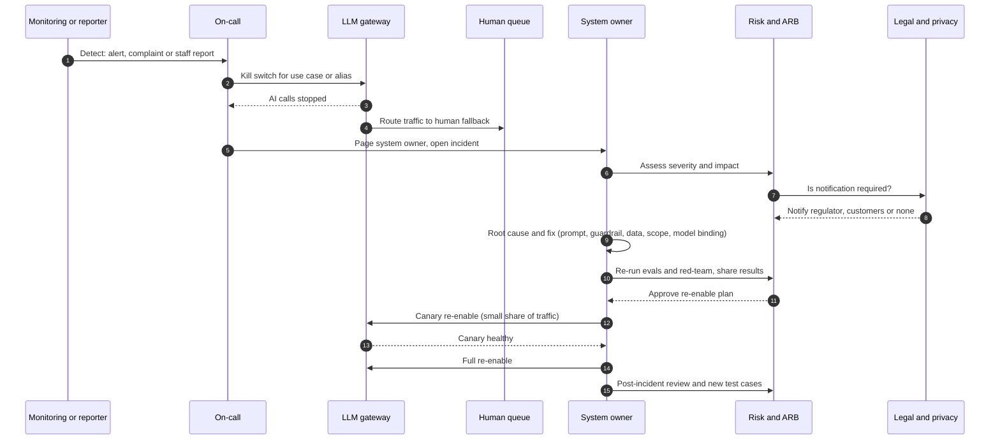

# Runbook: AI Incident

An AI incident is any event where an AI system causes, or could cause, harm: wrong or harmful output relied on, data exposure, unsafe action by an agent, guardrail bypass, unfair outcomes, runaway cost, or a vendor model change that breaks behaviour.

| 5W1H | Answer |
|---|---|
| **Who** | Detector (anyone), on-call engineer, system owner, platform on-call, risk, ARB chair, legal and privacy if notification may be needed |
| **What** | Steps to stop harm, fall back to humans, fix, re-evaluate and safely re-enable |
| **When** | As soon as an incident is suspected; do not wait for certainty to use the kill switch |
| **Where** | LLM gateway (kill switch), human review queue, incident tool, ARB decision log |
| **Why** | AI failures can spread fast and quietly; stopping early limits harm |
| **How** | Follow the steps below; record each step in the incident ticket |

## Severity

| Severity | Examples | Kill switch? | Who is told |
|---|---|---|---|
| SEV1 | Data exposure of confidential or restricted data; harmful action executed; material decisions affected | Yes, immediately | Owner, CISO, risk, legal, privacy, ARB chair |
| SEV2 | Widespread wrong answers; guardrail bypass without known harm; cost runaway | Usually | Owner, risk, ARB chair |
| SEV3 | Isolated wrong answers; minor quality drop | Optional | Owner |

## Sequence

## Steps

1. **Detect.** Sources: SLO alerts, guardrail block spikes, override spikes, cost alerts, user reports, vendor notices.
2. **Stop.** On-call activates the kill switch at the gateway for the use case (or the alias, if a model is the cause). Note the time.
3. **Fall back.** Confirm traffic is reaching the human queue or non-AI process. Tell the business team running the queue.
4. **Own.** Page the system owner. Open an incident ticket with: system id, use case id, tier, start time, symptoms, trace ids.
5. **Assess.** Owner with risk sets severity, scope (time window, users, records affected) and harm.
6. **Notify if required.** Legal and privacy decide on regulator, customer or partner notification and the deadline. Record the decision.
7. **Fix.** Find the root cause. Typical causes: prompt change, model binding or vendor update, data source change, missing permission filter, over-broad tool scope.
8. **Re-evaluate.** Run the quality and safety eval suites and relevant red-team cases. Add the incident as a new regression case.
9. **Canary re-enable.** With risk approval, re-enable for a small share of traffic or a pilot group. Watch SLOs.
10. **Full re-enable.** When the canary is healthy for the agreed period.
11. **Review.** Post-incident review within 10 working days. Update the decision log, threat model and runbooks.

## Evidence to keep

- Incident ticket and timeline.
- Trace ids and logs for the affected window.
- Notification decisions.
- Eval and red-team results before re-enable.
- Post-incident review.

## Kill switch test

Test the kill switch for each Tier 2 and Tier 3 system before release and every quarter. Record the result.
