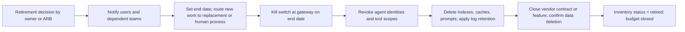

# Runbook: Model and AI System Retirement

Two cases: retiring a **model** (a binding behind an alias goes away) and retiring an **AI system** (a use case stops).

| 5W1H | Answer |
|---|---|
| **Who** | Platform team (models), system owner (systems), data owners, procurement, ARB |
| **What** | Steps to retire safely, delete derived data and update records |
| **When** | Provider deprecation, low value at review, replacement by a better system, policy or legal change |
| **Where** | Gateway, AI inventory, indexes, logs, vendor contracts |
| **Why** | Orphaned bots and stale indexes are risk without value |
| **How** | Plan → notify → migrate or switch off → delete derived data → update records |

## A. Retiring a model

1. Note the provider's retirement date. Start at least one full release cycle before it.
2. Follow the [model version change runbook](model-version-change.md) to move every alias that uses the model.
3. Remove the model from `approved-models.yaml` and `config/models.yaml`.
4. Record the change in the ADR or decision log.

## B. Retiring an AI system

### Steps

1. **Decide.** Owner or ARB records the decision and reason (low value, replaced, risk).
2. **Notify.** Users, support teams, dependent systems, and affected people if they were told about AI use.
3. **Replace.** Route work to the replacement system or the human process. Check the human team has capacity.
4. **Switch off.** Activate the kill switch for the use case on the end date.
5. **Revoke access.** Remove agent identities, tool scopes and API keys in [agent-scopes.yaml](../../security/identity/agent-scopes.yaml) and the identity provider.
6. **Delete derived data.** Vector indexes, caches, prompt registry entries, fine-tuned models. Keep logs only as long as the [logging standard](../../02-architecture/standards/logging-standard.md) requires.
7. **Vendors.** Turn off the feature or end the contract. Get written confirmation of data deletion.
8. **Records.** Set inventory `status: retired`, close the FinOps budget, archive the system card with the retirement date, keep the decision log.

## Orphan check

Quarterly, list systems with no owner, no traffic for 60 days, or no review within the tier's review period. Each gets an owner or a retirement decision.
