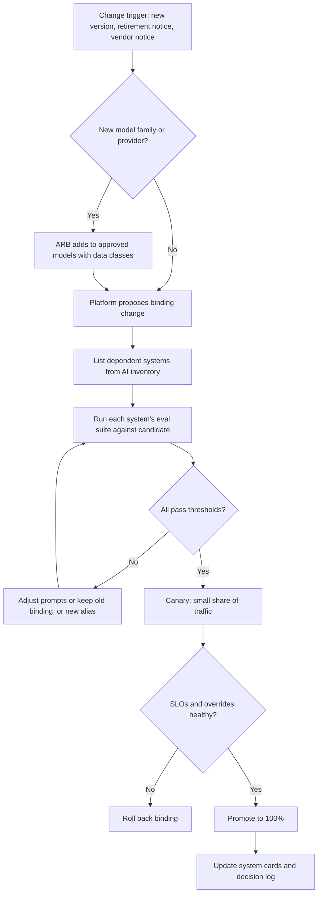

# Runbook: Model Version Change

Covers any change to what a model alias points to: a new model version, a new provider, a fine-tuned model, or a vendor-announced model update behind a product you use.

| 5W1H | Answer |
|---|---|
| **Who** | Platform team (binding owner), system owners of every system using the alias, ARB for new model families |
| **What** | Steps to change a model binding safely |
| **When** | Planned upgrades, provider retirement notices, vendor change notices, cost or quality improvements |
| **Where** | `config/models.yaml` (bindings), `approved-models.yaml` (approval and data classes), gateway |
| **Why** | A model change can change behaviour for many systems at once. Treat it as a release |
| **How** | Approve → evaluate per system → canary → promote → monitor |

## Flow

## Steps

1. **Record the trigger.** Planned upgrade, provider deprecation date, vendor notice or cost reason.
2. **Check approval.** A new model family or provider needs ARB approval and data-class rules in `approved-models.yaml`.
3. **Find dependents.** List every system in the AI inventory whose `models` includes the alias.
4. **Evaluate.** Run each dependent system's quality and safety suites against the candidate binding. Compare with the current binding. Tier 3 systems also re-run fairness tests.
5. **Decide.** All pass → proceed. Some fail → fix prompts, create a new alias for the systems that need the old behaviour, or postpone.
6. **Notify owners.** Tell system owners the date and expected differences.
7. **Canary.** Route a small share of traffic, or one low-risk system, to the new binding. Watch quality SLOs, override rates, latency and cost.
8. **Promote.** Move to 100%. Keep the old binding available for rollback for an agreed period.
9. **Update records.** System cards (`model_aliases` resolved model), decision log for Tier 2 and Tier 3 systems, `config/models.yaml` history.

## Vendor-managed models (no control over timing)

- Ask the vendor for notice (see [third-party AI policy](../../01-governance/policies/third-party-ai.md)).
- Run scheduled evals (weekly for Tier 2 and Tier 3) to detect behaviour change. A significant drop opens an incident.
- This guards against the *silent vendor update* anti-pattern.

## Rollback

Change the binding back in `config/models.yaml` and redeploy gateway config. Rollback should take minutes, not days.
