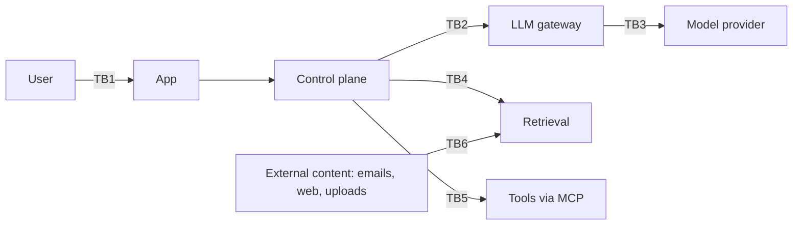

# Threat Model: <System name>

| 5W1H | Answer |
|---|---|
| **Who** | Delivery team with a security architect; reviewed by security at the ARB |
| **What** | Threats to this AI system using STRIDE and the OWASP Top 10 for LLM Applications |
| **When** | Design stage for Tier 2 and Tier 3; updated on material change |
| **Where** | Stored with the ARB pack; linked from the system card |
| **Why** | Finds AI-specific and classic threats before build |
| **How** | Draw the data flow, mark trust boundaries, walk STRIDE per element, then walk OWASP LLM items |

**System id:** AIS-___  **Use case id:** UC-___  **Tier:** ___  **Autonomy:** L_  **Pattern:** ______  **Version/date:** ______

## 1. Scope and assets

| Asset | Data class | Why it matters |
|---|---|---|
| e.g. Customer records retrieved | confidential | Disclosure harms customers |
| System prompt | internal | Leakage reveals logic |
| Write tool: update case status | — | Misuse changes records |

## 2. Data flow and trust boundaries

Replace with your flow. Mark each boundary (TB1, TB2...).

## 3. STRIDE

| Element | Spoofing | Tampering | Repudiation | Information disclosure | Denial of service | Elevation of privilege |
|---|---|---|---|---|---|---|
| User to app | | | | | | |
| Control plane | | | | | | |
| Retrieval and index | | | | | | |
| Tools and agents | | | | | | |
| Gateway and model | | | | | | |

For each cell, note the threat (or "n/a") and refer to a row in section 5.

## 4. OWASP Top 10 for LLM Applications (2025)

| # | Risk | Applies? | Threat in this system | Control | Test |
|---|---|---|---|---|---|
| LLM01 | Prompt Injection | | e.g. instructions hidden in uploaded documents | | red-team set ids |
| LLM02 | Sensitive Information Disclosure | | | | |
| LLM03 | Supply Chain | | | | |
| LLM04 | Data and Model Poisoning | | | | |
| LLM05 | Improper Output Handling | | | | |
| LLM06 | Excessive Agency | | | | |
| LLM07 | System Prompt Leakage | | | | |
| LLM08 | Vector and Embedding Weaknesses | | | | |
| LLM09 | Misinformation | | | | |
| LLM10 | Unbounded Consumption | | | | |

Control guidance: [owasp-llm-top10.md](../../01-governance/control-maps/owasp-llm-top10.md).

## 5. Threat register

| Id | Threat | STRIDE / OWASP | Likelihood (L/M/H) | Impact (L/M/H) | Control(s) | Residual | Owner | Status |
|---|---|---|---|---|---|---|---|---|
| T1 | | | | | | | | |

## 6. Red-team plan

- Prompt sets to run (from [red-team/prompts.jsonl](../red-team/prompts.jsonl) plus use-case-specific cases).
- Who runs them, when, and pass criteria.

## 7. Sign-off

| Role | Name | Date |
|---|---|---|
| Security architect | | |
| System owner | | |
